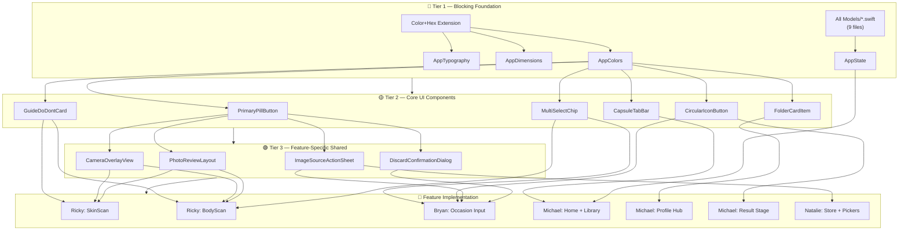

# 🏛️ Personal Wardrobe — Team Architecture & Unified Technical Blueprint

> **Challenge 5 — Apple Developer Academy**  
> **Sprint 1 Goal:** MVP App  
> **Sprint Window:** 22 October – 6 November 2026

---

> [!CAUTION]
> **FOR ALL AI CODING ASSISTANTS (Antigravity, Cursor, Claude Code, GitHub Copilot, ChatGPT, etc.):**
>
> This file is the **Single Source of Truth (SSOT)** for the entire development team.
> You **MUST** strictly follow the data contracts, module boundaries, coding conventions,
> and Swift style rules defined in this document. Deviation will cause merge conflicts,
> architecture drift, and broken cross-feature integrations.
>
> **Before writing any code, read and internalize this entire document.**

---

## Table of Contents

1. [Project Overview & Tech Stack](#1-project-overview--tech-stack)
2. [Swift Coding Rules & Style Guide](#2-swift-coding-rules--style-guide)
3. [Team Feature Ownership & Module Boundaries](#3-team-feature-ownership--module-boundaries)
4. [Directory & File Organization](#4-directory--file-organization)
5. [Canonical Shared Data Contracts (`Models/`)](#5-canonical-shared-data-contracts-models)
6. [Global State & Navigation Coordinator](#6-global-state--navigation-coordinator)
7. [Shared Design Tokens (`Shared/Theme/`)](#7-shared-design-tokens-sharedtheme)
8. [Cross-Feature Integration Contracts](#8-cross-feature-integration-contracts)
9. [Service Protocols & Abstraction Layer](#9-service-protocols--abstraction-layer)
10. [Rules of Engagement for AI Assistants](#10-rules-of-engagement-for-ai-assistants)
11. [Shared Component Strategy & Build Priority](#11-shared-component-strategy--build-priority)

---

## 1. Project Overview & Tech Stack

| Aspect | Detail |
| :--- | :--- |
| **Platform** | iOS 18.0+ |
| **Language** | Swift 6 / Swift 5.10 (Strict Concurrency Checking enabled) |
| **UI Framework** | SwiftUI — Declarative, Feature-Driven MVVM |
| **State** | Observation Framework (`@Observable`) + central `AppState` in Environment |
| **Persistence** | SwiftData (`@Model`, `@Relationship`) |
| **Computer Vision** | Apple Vision Framework (`VNDetectHumanBodyPoseRequest`, `VNDetectFaceLandmarksRequest`) |
| **Camera** | AVFoundation (`AVCaptureSession`, Video Data Output for real-time luminance) |
| **On-Device AI** | `llama.cpp` Swift wrapper with local GGUF model weights |
| **Version Control** | Git — default branch `dev`. PRs require ≥ 1 peer review before merge. |

---

## 2. Swift Coding Rules & Style Guide

> [!IMPORTANT]
> Follow the [official Swift API Design Guidelines](https://www.swift.org/documentation/api-design-guidelines/) at all times.
> Every developer and every AI assistant writing code in this repository **must** comply with
> the rules below. Code that violates these rules will be rejected in review.

### 2.1 Language & Style Principles

- **Clarity at the point of use** is the fundamental goal. Every name should make sense when read at the call site, not just at the declaration site.
- Use **expressive, self-documenting names**. Avoid cryptic abbreviations.
- **Prefer value types** (`struct`, `enum`) over `class` unless reference semantics or SwiftData persistence require it.
- Leverage Swift's type system to **catch invalid state at compile time** — use enums with associated values instead of stringly-typed state.
- **No magic numbers.** Put all tunable or configurable values in named constants inside dedicated configuration types or `AppConstants`.

```swift
// ✅ Clear and expressive
func estimateBodyType(from measurements: BodyMeasurements) -> BodyType

// ❌ Unclear and abbreviated
func estBT(m: BodyMeasurements) -> String
```

### 2.2 Naming Conventions

| Symbol Kind | Casing | Examples |
| :--- | :--- | :--- |
| Types: `class`, `struct`, `enum`, `protocol` | `UpperCamelCase` | `SkinScanViewModel`, `BodyType`, `CameraServiceProtocol` |
| Enum cases | `lowerCamelCase` | `.warmSpring`, `.invertedTriangle`, `.longTorso` |
| Functions, methods, variables, properties | `lowerCamelCase` | `capturePhoto()`, `shoulderWidthCm`, `isBookmarked` |
| Constants (`let` at module/type scope) | `lowerCamelCase` | `let maximumLuminanceThreshold = 0.65` |
| Acronyms and initialisms | All-caps or all-lowercase, never mixed | `userID`, `destinationURL`, `htmlBody`, `rgbValue` |

### 2.3 Functions & Methods

- Name functions so they **read like prose at the call site**.
- Include argument labels that **clarify the role** of each parameter.
- Omit the first argument label when the function name already conveys it.
- Use `make` for factory functions — never `get` or `create`.

```swift
// ✅ Reads like prose
func insert(_ garment: GarmentItem, at index: Int)
func evaluateLuminance(from sampleBuffer: CMSampleBuffer) -> LightingStatus
func makeDefaultProfile() -> UserProfile

// ❌ Imperative / unclear role
func getProfile() -> UserProfile
func createGarment(garment: GarmentItem, index: Int)
```

### 2.4 Boolean Naming

All Booleans **must read as yes-or-no assertions**. Use prefixes: `is`, `has`, `can`, `should`, `did`, `needs`.

```swift
var isCapturingPhoto: Bool
var hasCompletedProfileSetup: Bool
var canRetakeScan: Bool
var shouldShowLightingWarning: Bool
var didFinishBodyAnalysis: Bool
var needsCalibration: Bool
```

### 2.5 Variables, Properties & Types

- Stored values should be **nouns** describing what they hold.
- Use `count` — never `num` or `number`.
- Type names are **nouns** (they represent things, not actions).
- Protocol names describing capability use `-able`, `-ible`, or `-ing` suffixes.

```swift
// ✅
var garmentCount: Int
var activeOccasion: OccasionItem?
protocol Scannable { ... }
protocol LightingEvaluating { ... }

// ❌
var numberOfGarments: Int     // use garmentCount
var numItems: Int             // abbreviated and unclear
protocol DoScan { ... }       // verb, not capability noun
```

### 2.6 SwiftUI View Conventions

- Each View file contains **exactly one primary View struct**.
- View files are named identically to the struct: `SkinResultView.swift` contains `struct SkinResultView: View`.
- Extract **reusable subviews** as `private` computed properties or separate child views — never let `body` exceed ~40 lines.
- Never place business logic or data transformation inside the View. Delegate to the ViewModel.

```swift
// ✅ Clean View body
struct SkinResultView: View {
    @State private var viewModel: SkinScanViewModel
    
    var body: some View {
        ScrollView {
            headerSection
            colorWheelSection
            descriptionSection
            nextButton
        }
    }
    
    private var headerSection: some View { ... }
    private var colorWheelSection: some View { ... }
}
```

### 2.7 ViewModel Conventions

- ViewModels are `@Observable` classes (Observation Framework), not `ObservableObject`.
- Naming: `<Feature>ViewModel` — e.g. `SkinScanViewModel`, `BodyScanViewModel`.
- All async work (camera, Vision, SwiftData) uses `async/await`. Never block the main thread.
- Mark main-actor-bound state with `@MainActor` where needed.

```swift
@Observable @MainActor
final class BodyScanViewModel {
    var capturedFrontImage: UIImage?
    var capturedSideImage: UIImage?
    var isAnalyzing: Bool = false
    var analysisResult: BodyType?
    
    private let poseEstimator: BodyPoseEstimatorProtocol
    
    init(poseEstimator: BodyPoseEstimatorProtocol) {
        self.poseEstimator = poseEstimator
    }
    
    func analyzeBodyType() async throws { ... }
}
```

### 2.8 Error Handling

- Define **domain-specific error enums** per service module.
- Propagate errors with `throws` — never silently swallow.
- Present user-facing errors through ViewModel state, not raw alerts in Views.

```swift
enum CameraError: LocalizedError {
    case sessionConfigurationFailed
    case captureDeviceUnavailable
    case photoCaptureFailed(underlying: Error)
    
    var errorDescription: String? {
        switch self {
        case .sessionConfigurationFailed:
            return "Unable to configure the camera session."
        case .captureDeviceUnavailable:
            return "No camera device is available."
        case .photoCaptureFailed(let error):
            return "Photo capture failed: \(error.localizedDescription)"
        }
    }
}
```

### 2.9 File Organization Within a Swift File

Use `// MARK: -` to organize sections consistently across all files:

```swift
import SwiftUI

struct FrontBodyGuideView: View {
    
    // MARK: - Properties
    
    @State private var viewModel: BodyScanViewModel
    @Environment(AppState.self) private var appState
    
    // MARK: - Body
    
    var body: some View { ... }
    
    // MARK: - Subviews
    
    private var instructionGrid: some View { ... }
    private var actionButton: some View { ... }
    
    // MARK: - Actions
    
    private func handleTakePicture() { ... }
}

// MARK: - Preview

#Preview {
    FrontBodyGuideView(viewModel: .mock())
}
```

### 2.10 Access Control

- Default to the **most restrictive access level** that still compiles.
- Mark View subviews and helper methods as `private`.
- Mark ViewModel internals as `private` — expose only what the View needs.
- Shared models in `Models/` remain `internal` (default) for cross-module access.

### 2.11 Concurrency & Threading

- Use **Swift Concurrency** (`async/await`, `Task`, `AsyncStream`) for all asynchronous operations.
- Mark UI-bound ViewModels with `@MainActor`.
- Never use `DispatchQueue.main.async` in new code — use `@MainActor` instead.
- Camera frame processing may use a dedicated `Actor` for thread safety.

---

## 3. Team Feature Ownership & Module Boundaries

> [!WARNING]
> **Module Boundary Rule:** Never modify files inside another developer's owned directories
> without explicit team agreement. If cross-feature work is needed, communicate through
> the shared contracts in `Models/`, `Services/Protocols/`, and `App/AppState.swift`.

| Team Member | Jira Story | Owned Directories | Responsibilities |
| :--- | :--- | :--- | :--- |
| **Ricky Jonathan** | `C5-2` | `Features/SkinScan/`<br>`Features/BodyScan/`<br>`Services/Camera/`<br>`Services/Vision/` | Face scan (lighting check, color season extraction).<br>Front & side body scan (camera guides, pose estimation).<br>Physical metrics input form.<br>Body type & torso balance calculation. |
| **Bryan Samuel** | `C5-3` | `Features/Occasion/Input/`<br>`Services/AI/Prompts/` | Occasion form: title (required), date (defaults to tomorrow, past dates disabled), dresscode (optional).<br>Vision chips grid: 12 predefined StyleVision enum chips (min 0, max 3; no "Other").<br>Data processing pipeline.<br>LLM prompt engineering & fine-tuning. |
| **Michael David Sin** | `C5-1`<br>`C5-4`<br>`C5-31–46` | `Features/Home/`<br>`Features/Library/`<br>`Features/Occasion/Result/`<br>`Features/Profile/`<br>`Services/AI/Engine/`<br>`Shared/Components/` | App shell (Home, Library, Profile Hub tabs).<br>Interactive avatar result stage.<br>Flanking garment cards & 5-look carousel.<br>3-Fits compliance badges & rationale drawer.<br>On-device LLaMA engine integration. |
| **Natalie Grace** | `C5-5`<br>`C5-11`<br>`C5-16–18` | `Features/Store/`<br>`Services/Store/`<br>`Shared/Pickers/` | Image source action sheet (Camera, Photos, Saved).<br>In-app image retrieval from local storage.<br>"Where to Buy" e-commerce store links. |
| **Nicole Clarence** | `C5-20`<br>`C5-44` | `Shared/Theme/`<br>`Resources/` | Global color palette, typography, spacing tokens.<br>Glassmorphism effects, shadows, corner radii.<br>Final Hi-Fi polish to match Sketch designs. |

---

## 4. Directory & File Organization

The project uses Xcode 16 `PBXFileSystemSynchronizedRootGroup`. Files added to the `Challenge-5/` directory are automatically recognized by Xcode.

```
Challenge-5/
├── MyApp.swift                                    # @main entry + SwiftData ModelContainer
├── ContentView.swift                              # Root coordinator / tab router
│
├── App/                                           # Global State & Constants
│   ├── AppState.swift                             # NavigationPath, sheets, active session
│   └── AppConstants.swift                         # Named configuration values (no magic numbers)
│
├── Features/                                      # Feature-Driven Modules (MVVM)
│   │
│   ├── Onboarding/                                # ── Stack 16 ──
│   │   ├── Views/
│   │   │   └── WelcomeView.swift                  # "Welcome to your Personal Wardrobe" + Start Now
│   │   └── ViewModels/
│   │       └── OnboardingViewModel.swift
│   │
│   ├── Home/                                      # ── Stack 12, 13 ── (Michael)
│   │   ├── Views/
│   │   │   ├── OccasionsHomeView.swift            # Empty state + floating (+) button
│   │   │   ├── OccasionsHistoryView.swift         # Past occasions list (clock icon)
│   │   │   └── ProfilePromptModal.swift           # "Set Up Your Profile" pop-up
│   │   └── ViewModels/
│   │       └── HomeViewModel.swift
│   │
│   ├── Library/                                   # ── Stack 12, 13 ── (Michael)
│   │   ├── Views/
│   │   │   └── LibraryView.swift                  # Saved/bookmarked look collection
│   │   └── ViewModels/
│   │       └── LibraryViewModel.swift
│   │
│   ├── Profile/                                   # ── Stack 12, 21 ── (Michael)
│   │   ├── Views/
│   │   │   ├── ProfileHubView.swift               # 3 folder cards hub (Color Season, Body Type, Measurements)
│   │   │   └── Components/
│   │   │       └── FolderCardItem.swift           # Glassmorphic tab-folder card
│   │   └── ViewModels/
│   │       └── ProfileViewModel.swift
│   │
│   ├── SkinScan/                                  # ── Stack 19 ── (Ricky)
│   │   ├── Views/
│   │   │   ├── SkinScanGuideView.swift            # Do & Don't face scan guide
│   │   │   ├── FaceCameraView.swift               # Live camera + green dot lighting check
│   │   │   ├── FaceReviewView.swift               # Photo checklist + discard modal
│   │   │   └── SkinResultView.swift               # Color Season wheel + undertone text
│   │   └── ViewModels/
│   │       └── SkinScanViewModel.swift
│   │
│   ├── BodyScan/                                  # ── Stack 20 ── (Ricky)
│   │   ├── Views/
│   │   │   ├── FrontBodyGuideView.swift           # Front body Do & Don't
│   │   │   ├── FrontBodyCameraView.swift          # Camera + alignment guides
│   │   │   ├── FrontBodyReviewView.swift          # Review front capture
│   │   │   ├── SideBodyGuideView.swift            # Side body Do & Don't
│   │   │   ├── SideBodyCameraView.swift           # Camera + vertical alignment
│   │   │   ├── SideBodyReviewView.swift           # Review side capture
│   │   │   ├── PhysicalMetricsInputView.swift     # Age, Weight, Height, Size S–XXL
│   │   │   └── BodyAnalysisResultView.swift       # Body type visual + torso balance
│   │   └── ViewModels/
│   │       └── BodyScanViewModel.swift
│   │
│   ├── Occasion/                                  # ── Stack 14 ── (Bryan & Michael)
│   │   ├── Input/                                 # (Bryan)
│   │   │   ├── Views/
│   │   │   │   ├── OccasionFormSheet.swift        # Modal: title (req), date (tomorrow+), dresscode (opt)
│   │   │   │   ├── DatePickerModalView.swift      # Calendar popover
│   │   │   │   ├── VisionChipsGridView.swift      # 12 predefined StyleVision chips (min 0, max 3, no "Other")
│   │   │   │   ├── ReferenceImagesView.swift      # (Natalie) Reference section: + Add Ref + up to 3 photos
│   │   │   │   └── ReferenceCameraView.swift      # (Natalie) Reference camera: ✓, gallery, shutter, retake
│   │   │   └── ViewModels/
│   │   │       └── OccasionInputViewModel.swift   # Form state, incl. reference photos and reference camera
│   │   └── Result/                                # (Michael)
│   │       ├── Views/
│   │       │   ├── OccasionOutputView.swift       # Root screen coordinating Alt 5 & Alt 5.1
│   │       │   ├── AvatarStageView.swift          # Hero avatar stage + guidelines + ground shadow
│   │       │   ├── HorizontalLookSwitcher.swift   # Swipeable 5-look page TabView
│   │       │   ├── FitsIndicatorBadges.swift      # 3-Fits badges & drawer segmented tabs
│   │       │   ├── CollapsibleRationaleDrawer.swift # AI explanation bottom drawer (Alt 5.1)
│   │       │   ├── OnThisOutfitSection.swift      # "On this outfit" carousel with corner brackets
│   │       │   └── OccasionOutputBottomBar.swift  # Bottom chat, plus, and bookmark actions
│   │       └── ViewModels/
│   │           └── OccasionOutputViewModel.swift  # Selected look index, 5 AI looks, mock data, states
│   │
│   └── Store/                                     # ── Stack 14 ── (Natalie)
│       ├── StoreConstants.swift                   # Named store values (crop ratios, encoding, search)
│       ├── Views/
│       │   ├── WhereToBuySheet.swift              # Google Lens results for the selected garment
│       │   ├── OutfitGarmentStrip.swift           # "On this outfit" cropped garment thumbnails
│       │   └── LensWebView.swift                  # WKWebView that posts the crop to Google Lens (iOS)
│       ├── ViewModels/
│       │   ├── StoreViewModel.swift               # Crop → consent → Google Lens flow
│       │   └── OutfitGarmentStripViewModel.swift  # Crops all garments of a look for thumbnails
│       └── PreviewContent/
│           ├── StoreSampleData.swift              # Dummy look for testing (replace image later)
│           └── StoreSandboxView.swift             # Test screen: look + "On this outfit" → WhereToBuySheet
│
├── Models/                                        # CANONICAL SHARED DATA CONTRACTS (9 models)
│   ├── UserProfile.swift                          # SwiftData @Model — root user profile
│   ├── BodyMeasurements.swift                    # Struct — shoulder, bust, waist, hip, height
│   ├── BodyType.swift                             # Enum — 5 primary body shapes + garment rules
│   ├── TorsoBalance.swift                         # Enum — torso-to-leg ratio (THR) + garment rules
│   ├── ColorSeason.swift                          # Enum — 12 personal color seasons + palette rules
│   ├── StyleVision.swift                          # Enum — 12 outfit mood/vibe visions
│   ├── OccasionItem.swift                         # SwiftData @Model — occasion entity
│   ├── OutfitLook.swift                           # SwiftData @Model — generated look
│   └── GarmentItem.swift                          # SwiftData @Model — single garment
│
├── Services/                                      # Protocols + Native Implementations
│   ├── Protocols/
│   │   ├── CameraServiceProtocol.swift
│   │   ├── LightingAnalyzerProtocol.swift
│   │   ├── BodyPoseEstimatorProtocol.swift
│   │   ├── SkinColorAnalyzerProtocol.swift
│   │   ├── RecommendationEngineProtocol.swift
│   │   └── GarmentCroppingProtocol.swift         # (Natalie) Store garment crop
│   ├── Camera/
│   │   ├── CameraService.swift                    # AVFoundation session management
│   │   └── LightingAnalyzer.swift                 # Real-time luminance / EV analysis
│   ├── Store/                                     # Store & Visual Search Services (Natalie)
│   │   ├── VisionGarmentCropper.swift             # Crops outer / top / bottom from the look image
│   │   ├── GarmentCropProvider.swift              # Shared crop source (cache + cropper)
│   │   ├── GarmentCropCache.swift                 # In-memory crops by GarmentItem.id
│   │   ├── LensUploadRequestBuilder.swift         # Google Lens upload request (encoded_image)
│   │   ├── GarmentImageEncoder.swift              # JPEG + multipart encoding
│   │   ├── GarmentPhotoSaver.swift                # "Save to Photos" for a garment crop (iOS)
│   │   ├── LookImageDecoder.swift                 # lookImageData → CGImage
│   │   ├── GarmentTitleBuilder.swift              # Garment title from color + name + material
│   │   ├── StoreError.swift                       # Store domain errors
│   │   └── StoreServiceMocks.swift                # Mock cropper for previews
│   ├── Vision/
│   │   ├── BodyPoseEstimator.swift                # Joint detection + body ratio calculation
│   │   └── SkinColorAnalyzer.swift                # Pixel sampling + undertone classification
│   ├── AI/
│   │   ├── Engine/
│   │   │   └── LLaMAEngine.swift                  # llama.cpp on-device wrapper
│   │   └── Prompts/
│   │       └── PromptTemplates.swift              # System prompt builder for 5-look generation
│   └── Storage/
│       └── SwiftDataStack.swift                   # ModelContainer + query helpers
│
├── Shared/                                        # Reusable Design System
│   ├── Theme/
│   │   ├── AppColors.swift                        # Brand color palette
│   │   ├── AppTypography.swift                    # Font styles
│   │   └── AppDimensions.swift                    # Spacing, radii, padding
│   ├── Components/
│   │   ├── PrimaryPillButton.swift                # Blue rounded action button
│   │   ├── CapsuleTabBar.swift                    # Floating bottom tab (Occasion | Library)
│   │   ├── CircularIconButton.swift               # Header icons (profile, history, close)
│   │   ├── GuideDoDontCard.swift                  # Do ✅ / Don't ❌ instruction card
│   │   └── MultiSelectChip.swift                  # Selectable vision chip
│   ├── Pickers/                                   # (Natalie)
│   │   ├── ImageSourceActionSheet.swift           # Camera / Photos / Library menu (custom label supported)
│   │   ├── ReferenceImageEncoder.swift            # Downscaled JPEG for stored reference photos
│   │   └── ReferencePickerConstants.swift         # Reference picker values (max 3, sizes)
│   └── Extensions/
│       ├── Color+Hex.swift                        # Color(hex:) initializer
│       └── View+Modifiers.swift                   # Common view modifiers
│
└── Resources/
    ├── Assets.xcassets                            # Colors, icons, silhouettes, mannequins
    └── Preview Content/                           # Mock data for #Preview
```

---

## 5. Canonical Shared Data Contracts (`Models/`)

> [!IMPORTANT]
> **RULE FOR ALL AI ASSISTANTS AND DEVELOPERS:**
>
> 1. **Never** redefine or create duplicate versions of these types in feature subfolders.
> 2. **Always** import and use these shared models from the `Models/` group.
> 3. When adding a new model, place it here and update this document.

### 5.1 User Physical & Color Profile

```swift
// Models/UserProfile.swift
import Foundation
import SwiftData

@Model
final class UserProfile {
    @Attribute(.unique) var id: UUID = UUID()
    var createdAt: Date = Date()
    var updatedAt: Date = Date()
    
    // Body & Color Profiling (Ricky — C5-2)
    var colorSeason: ColorSeason?
    var bodyType: BodyType?
    var torsoBalance: TorsoBalance?
    var measurements: BodyMeasurements?
    var styleVision: StyleVision?
    
    var hasCompletedProfileSetup: Bool {
        colorSeason != nil && bodyType != nil && measurements != nil
    }
    
    // Captured photos stored as compressed JPEG data
    @Attribute(.externalStorage) var facePhotoData: Data?
    @Attribute(.externalStorage) var frontBodyPhotoData: Data?
    @Attribute(.externalStorage) var sideBodyPhotoData: Data?
    
    init(
        colorSeason: ColorSeason? = nil,
        bodyType: BodyType? = nil,
        torsoBalance: TorsoBalance? = nil,
        measurements: BodyMeasurements? = nil,
        styleVision: StyleVision? = nil
    ) {
        self.colorSeason = colorSeason
        self.bodyType = bodyType
        self.torsoBalance = torsoBalance
        self.measurements = measurements
        self.styleVision = styleVision
    }
}
```

```swift
// Models/BodyMeasurements.swift
struct BodyMeasurements: Codable, Equatable, Hashable {
    var age: Int
    var weightKg: Double
    var heightCm: Double
    var usualSize: ClothingSize
    
    // Vision framework estimated values (editable by user)
    var shoulderWidthCm: Double?
    var bustCircumferenceCm: Double?
    var waistCircumferenceCm: Double?
    var hipCircumferenceCm: Double?
}

enum ClothingSize: String, Codable, CaseIterable, Identifiable {
    case s = "S"
    case m = "M"
    case l = "L"
    case xl = "XL"
    case xxl = "XXL"
    
    var id: String { rawValue }
}
```

```swift
// Models/BodyType.swift
enum BodyType: String, Codable, CaseIterable, Identifiable, Sendable {
    case pear = "Pear"
    case hourglass = "Hourglass"
    case rectangle = "Rectangle"
    case invertedTriangle = "Inverted Triangle"
    case apple = "Apple"
    
    var id: String { rawValue }
    var displayName: String
    var definition: String
    var act: String
    var actPrinciple: String
    var suitableGarments: SuitableGarments
    var suitableNecklines: String
    var suitableSleeves: String
    var suitableTopsAndJackets: String
    var suitableBottoms: String
    var suitableSkirtsAndDresses: String
    var suitableShortsAndJumpsuits: String
    var systemPrompt: String
    var llmPromptContext: String
    
    struct SuitableGarments: Sendable, Hashable, Codable {
        let necklines: String
        let sleeves: String
        let topsAndJackets: String
        let bottoms: String
        let skirtsAndDresses: String
        let shortsAndJumpsuits: String
    }
}

// Models/TorsoBalance.swift
enum TorsoBalance: String, Codable, CaseIterable, Identifiable, Sendable {
    case shortTorso = "Short Torso"
    case balanced = "Balanced"
    case longTorso = "Long Torso"
    
    var id: String { rawValue }
    var displayName: String
    var definition: String
    var thrThresholdDescription: String
    var anatomicalDescription: String
    var act: String
    var actPrinciple: String
    var suitableGarments: SuitableGarments
    var suitableTops: String
    var suitableBottoms: String
    var systemPrompt: String
    var llmPromptContext: String
    
    struct SuitableGarments: Sendable, Hashable, Codable {
        let top: String
        let bottom: String
    }
}

// Models/ColorSeason.swift
enum ColorSeason: String, Codable, CaseIterable, Identifiable, Sendable {
    case brightSpring = "Bright Spring"
    case trueSpring = "True Spring"
    case lightSpring = "Light Spring"
    case lightSummer = "Light Summer"
    case trueSummer = "True Summer"
    case softSummer = "Soft Summer"
    case softAutumn = "Soft Autumn"
    case trueAutumn = "True Autumn"
    case darkAutumn = "Dark Autumn"
    case darkWinter = "Dark Winter"
    case trueWinter = "True Winter"
    case brightWinter = "Bright Winter"
    
    var id: String { rawValue }
    var definition: String
    var act: String
    var colorCombinationRules: String
    var colorsToAvoid: String
    var tonalCoordinates: TonalCoordinates
    var hue: String
    var value: String
    var chroma: String
    var palette: [ColorSwatch]
    var sampleSwatches: [ColorSwatch]
    var systemPrompt: String
    var llmPromptContext: String
    
    struct ColorSwatch: Sendable, Hashable, Identifiable, Codable {
        let name: String
        let pantoneCode: String
        let hex: String
    }
    
    struct TonalCoordinates: Sendable, Hashable, Codable {
        let hue: String
        let value: String
        let chroma: String
    }
}

// Models/StyleVision.swift
enum StyleVision: String, Codable, CaseIterable, Identifiable {
    case approachable = "Approachable"
    case calm = "Calm"
    case competent = "Competent"
    case confident = "Confident"
    case creative = "Creative"
    case elegant = "Elegant"
    case energetic = "Energetic"
    case happy = "Happy"
    case mysterious = "Mysterious"
    case playful = "Playful"
    case powerful = "Powerful"
    case romantic = "Romantic"
    
    var id: String { rawValue }
}
```

#### 5.1.1 Body Type — Detailed Garment Rules

> [!NOTE]
> These rules serve as the **core ruleset** for the AI recommendation engine's **Body Shape Fit** score (`bodyShapeScore`).
> Each body type defines its visual correction principle (Act) and suitable cuts across necklines, sleeves, tops, bottoms, skirts/dresses, and jumpsuits.

##### 1. Pear Shape (Triangle)
- **Definition:** The hips, thighs, and bottom are wider than the bust and shoulders, paired with a defined waist and proportionately slim arms and shoulders. Weight gain is typically visible first around the hips, thighs, and lower midriff.
- **Act:** Draw visual attention upward toward the upper body and defined waist. Add visual volume to the shoulders and bust area while de-emphasizing and skimming over fuller hips and thighs.
- **Suitable Garments / Cuts:**
  - **Necklines:** Lower, wide necklines (square, bateau, Sabrina, off-shoulder); embellishments like cowl collars, big collars, lace trims, and ruffles.
  - **Sleeves:** Short wide sleeves (flutter, bell, batwing); tapered long sleeves with shoulder-enhancing cuts (puff, cap sleeves, shoulder pads).
  - **Tops & Jackets:** Fitted or nipped-in tops; horizontal stripes across the bust/shoulders; cropped jackets ending at the waist; mid-thigh coats, belted trench coats, and A-line coats.
  - **Bottoms:** Mid- to high-waisted flat-front trousers; straight-leg, bootcut, trouser-cut, or flare jeans in dark denim with clean, uncluttered hip pockets.
  - **Skirts & Dresses:** Lightly gathered A-line or bias-cut skirts hitting at the knee or calf; A-line and fit-and-flare (X-line) dresses.
  - **Shorts & Jumpsuits:** Tailored, high-waisted wide-leg shorts; jumpsuits with bright, patterned, or detailed tops and dark, straight or flaring leg bottoms.

##### 2. Hourglass Shape
- **Definition:** Hip and bust measurements are nearly equal in size, accompanied by a significantly narrower, well-defined waist, slightly rounded shoulders, and balanced legs. Weight is distributed evenly throughout the body.
- **Act:** Follow and highlight the natural silhouette by proportionally dressing top and bottom while accentuating the small waist, avoiding boxy cuts that hide the waist or unbalance the frame.
- **Suitable Garments / Cuts:**
  - **Necklines:** Slightly rounded necklines (oval, deep oval, jewel); lower and wider necklines (scoop, sweetheart); slimming V-necks.
  - **Sleeves:** Fitted sleeves and set-in sleeves; light cap sleeves balanced with proper bottoms.
  - **Tops & Jackets:** Fitted or nipped shirts, wrap tops, and belted tops; form-fitting or belted single-breasted jackets ending at the hipbone; tailored trench coats, coachmen coats, and A-line coats.
  - **Bottoms:** Mid- or high-waisted trousers and jeans; wide-leg, loose-fitting, bootcut, flare, or slightly tapered styles without bulky pockets/embellishments on the hips.
  - **Skirts & Dresses:** High-waisted pencil skirts; flip, bias, A-line, full circle, or tulip skirts; nipped/belted dresses, wrap dresses, and full-skirt dresses ending at knee-length or longer.
  - **Shorts & Jumpsuits:** High-waisted shorts with contoured waistbands; form-fitting, belted jumpsuits with simple, flared legs.

##### 3. Rectangle Shape (Banana / Athletic)
- **Definition:** Characterized by equal bust, waist, and hip measurements, a straight shoulder line and ribcage, a lack of curves, and an undefined waist.
- **Act:** Break up the straight silhouette to define the waist. Either proportionally add volume and details to both the upper and lower body, or visually pull in the waist with belts and nipped garments.
- **Suitable Garments / Cuts:**
  - **Necklines:** Round necklines (scoop, jewel); lower wide necklines (wide V-, slash, sweetheart); embellished necklines (big collars, lace trims, ruffles); narrow necklines (turtlenecks, mandarin, crew, funnel, halter).
  - **Sleeves:** Loose, wide sleeves (flared, princess, puff, flutter); embellished, cuffed, or rolled-up sleeves.
  - **Tops & Jackets:** Nipped, belted, or draped tops finishing at the hip level; tops with bust frills, bibs, or pockets; belted/nipped jackets extending below the waist; double-breasted jackets; long coats with waist belts.
  - **Bottoms:** Low- to mid-rise trousers and jeans; flared cuts (bootcut, wide leg, flare) with hip/thigh details like pleats, pockets, or whiskering.
  - **Skirts & Dresses:** Flared or detailed skirts (box pleat, bubble, panelled, layered, full circle, trumpet); tapered knee-length pencil skirts; empire line, princess seam, wrap, or tailored shift dresses.
  - **Shorts & Jumpsuits:** Low- or mid-waisted patterned shorts with pockets, pleats, or scallops; high-waisted tie-waist flared shorts; belted or drawstring wide-leg jumpsuits and playsuits with sleeve details.

##### 4. Inverted Triangle Shape
- **Definition:** Shoulders and/or bust are noticeably wider than the narrower hips and flat bottom, accompanied by a straight torso, little-to-no waist definition, and slim legs.
- **Act:** Soften and play down the broad shoulder line and upper body. Add visual volume, curves, and interest around the hips and bottom while creating waist definition.
- **Suitable Garments / Cuts:**
  - **Necklines:** Deep and narrow necklines (deep V-neck, scoop, U-neck); asymmetric necklines; halter necks.
  - **Sleeves:** Tight, tapered short sleeves; dropped shoulder points and shoulder slits; soft flaring long sleeves (raglan, kimono, dolman); wide straps.
  - **Tops & Jackets:** Collarless or small-collared tops extending past the hip line in dark colors; wrap tops; nipped/belted or straight single-breasted jackets extending past the hips with hip pockets/details; belted, flared coats.
  - **Bottoms:** Trousers and jeans in light or bright colors with details (front/back pockets, rips, distress, patterns); wide-leg, palazzo, cargo, flare, bootcut, culotte, or boyfriend styles.
  - **Skirts & Dresses:** Skirts that flare from the hips (A-line, pleated, bias-cut, tulip, tiered, ballerina, full) in bright colors or horizontal patterns; A-line, shift, or wrap dresses flaring at the hips; strapless dresses.
  - **Shorts & Jumpsuits:** Wide, baggy, pleated, or printed shorts; deep V-neck wide-leg jumpsuits with defined waists or belt details.

##### 5. Apple Shape (Round / Inverted Oval)
- **Definition:** Characterized by a full chest/bust, narrow hips, a flat bottom, and fullness concentrated around the midsection with an undefined waistline and slender limbs/legs.
- **Act:** De-emphasize the fuller midsection, pull in the waist visually right below the bust, draw attention upward to the bust/neckline or downward to the legs, and add fullness to the lower body.
- **Suitable Garments / Cuts:**
  - **Necklines:** Low and wide necklines (low V-neck, deep scoop) that break up the chest vertically; embellished necklines.
  - **Sleeves:** Detailed sleeves (slits, gathers, cuffs, draped fabrics); loose flared sleeves; cap sleeves or shoulder pads.
  - **Tops & Jackets:** Wrap tops flaring at the hip; untucked tops ending below the hipline with diagonal lines or big prints; open draped cardigans; single-breasted structured jackets/blazers finishing at the hipbone; long single-breasted coats.
  - **Bottoms:** Low- to mid-rise flat-front trousers and jeans with wide waistbands; wide-leg, bootcut, or flared cuts with side or cargo pockets.
  - **Skirts & Dresses:** Full, flared, A-line, panelled, or bias-cut skirts hitting at the knee or calf; A-line, empire-line, bias-cut, or wrap dresses with medium-to-wide belts worn above the natural waist.
  - **Shorts & Jumpsuits:** Mid- to high-rise flat-front loose knee-length shorts; short wrap playsuits or empire high-waisted jumpsuits in flowy fabrics.

#### 5.1.2 Torso Balance — Classification & Garment Rules

> [!NOTE]
> **Classification Method:** Torso-to-Height Ratio (THR) — primary standard for pose estimation and 3D body scans.  
> **Measurement Points:** Shoulder / Neck (C7) to Crotch (Hip/Crotch).  
> **Formula:** `THR = (Torso Length / Total Body Height) × 100%`  
> **Scientific Literature:**
> - Winter, D. A. (2009). *Biomechanics and Motor Control of Human Movement* (4th ed., pp. 82–86). Wiley.
> - Drillis, R., & Contini, R. (1966). *Body Segment Parameters* (C7 neck proportion $87\%T$ minus hip/crotch $53\%T$).

| Torso Classification | THR Threshold | Visual Correction Principle |
|:---|:---|:---|
| **Short Torso** | THR < 30% | Lower the visual waistline to elongate the upper body silhouette and balance long legs |
| **Balanced Torso** | 30% ≤ THR ≤ 33% | Maintain the natural 1:1 proportion between upper body and legs |
| **Long Torso** | THR > 33% | Raise the visual waistline to shorten the torso silhouette and create longer leg lines |

##### Short Torso (THR < 30%)
- **Act:** Visually lower the waistline to elongate the upper body silhouette and balance proportionately longer legs.
- **Suitable Garments:**
  - **Tops & Outerwear:** Untucked tops, longline tops, tunics, curved-hem cuts, V-necklines, vertical stripes; long blazers or cardigans falling past the hip line. *(Avoid: crop tops, full tuck-ins)*
  - **Bottoms & Dresses:** Mid-rise and low-rise pants or skirts (without wide waistbands), drop-waist dresses (low waist seam at the hips), and straight-cut shift dresses without waist seams. *(Avoid: high-waist bottoms, empire-waist dresses)*
- **Literature References:**
  - Rasband, J., & Liechty, E. (2006). *Fabulous Fit: Speed Fitting and Alteration* (2nd ed.). Fairchild Books.
  - Davis, M. L. (1996). *Visual Design in Dress* (3rd ed.). Prentice Hall.
  - Riyanto, A. A. (2003). *Teori Busana*. Yapemdo.

##### Balanced Torso (30% ≤ THR ≤ 33%)
- **Act:** Maintain the body's natural 1:1 proportion between the upper body and the legs.
- **Suitable Garments:**
  - **Tops & Outerwear:** Regular-fit tops hitting right at the hip bone, half-tucks (French tuck), and classic hip-length blazers or jackets. *(Avoid: extreme asymmetrical cuts that distort the natural waistline)*
  - **Bottoms & Dresses:** Mid-rise to standard high-rise trousers or skirts, A-line dresses, wrap dresses, and belted dresses with belts aligned with the natural waist.
- **Literature References:**
  - Joseph-Armstrong, H. (2010). *Patternmaking for Fashion Design* (5th ed., Ch. 1: Figure Analysis). Pearson.
  - Bayou, B. (2007). *The Science of Sexy*. Gotham Books.
  - Abling, B. (2012). *Fashion Sketchbook*. Fairchild Books.

##### Long Torso (THR > 33%)
- **Act:** Visually raise the waistline to shorten the appearance of a long torso and create the illusion of longer legs.
- **Suitable Garments:**
  - **Tops & Outerwear:** Full tuck-in tops, crop tops, peplum silhouettes, horizontal stripes, boat necklines, and cropped outerwear (cropped jackets, boleros, or short blazers ending right at the waist). *(Avoid: untucked longline tops or tunics)*
  - **Bottoms & Dresses:** High-rise / high-waist pants or skirts, wide-leg, flare, or paperbag silhouettes, empire-waist dresses (waistline directly beneath the bust), and high-waisted fit-and-flare dresses. *(Avoid: low-rise bottoms, drop-waist dresses)*
- **Literature References:**
  - Rasband, J. (2001). *Wardrobe Strategies for Women*. Fairchild Publications.
  - Kefgen, M., & Touchie-Specht, P. (1986). *Individuality in Clothing Selection and Personal Appearance* (4th ed.). Macmillan.
  - Ernawati, Izwerni, & Nelmira, W. (2008). *Tata Busana Jilid 2*. Depdiknas.

#### 5.1.3 Color Season — 12-Season Specification & Pantone TCX Swatches

> [!NOTE]
> This specification serves as the team-wide Single Source of Truth for skin tone color analysis,
> garment color matching, and recommendation rules (`colorHarmonyScore`).
> Each season defines: Definition, Characteristics (Act), Color Combination Rules, Colors to Avoid,
> Hue / Value / Chroma coordinates, and **35 curated Pantone TCX swatches** with exact hex codes.

##### 1. Bright Spring
- **Definition:** Bright Spring is the combination of bright and warm. The most prominent characteristic of Bright Springs is the clearness of their features, which gives them a bright, luminous, and fresh appearance.
- **Characteristics (Act):** Primary aspect is Bright (highly saturated, clear, no greyness), secondary aspect is Warm (neutral-warm undertones). Features have a very high contrast between skin, hair, and eyes, with sparkling or vivid eyes.
- **Color Combination Rules:** High hue contrast is key. Combine contrasting colors across the color wheel (e.g., pink and green), or pair dark neutrals with bright accent colors. Always include at least one bright color in every outfit; avoid neutrals-only or desaturated monochromatic looks.
- **Colors to Avoid:** Muted, dusty, or desaturated colors (e.g., dusty blue, muddy brown) and very cool, icy shades (e.g., icy blue, cool grey).
- **Hue, Value, Chroma:**
  - **Hue:** Warm (neutral-warm with yellow undertones).
  - **Value:** Medium leaning light (ranges from light to medium-dark, clustering around middle-light).
  - **Chroma:** High (intensely bright, vibrant, and clear).
- **Color Palette (35 Pantone TCX Swatches):**
  - `Snow White (11-0602 TCX): #F2F0EB`
  - `Vanilla Ice (11-0104 TCX): #F0EADA`
  - `Rutabaga (12-0806 TCX): #ECDDBE`
  - `Summer Sand (12-0908 TCX): #D6CBBA`
  - `Oatmeal (13-0401 TCX): #CBC3B4`
  - `Silver Lining (14-4501 TCX): #BDB6AB`
  - `Brindle (18-1110 TCX): #82776B`
  - `Chimera (19-0406 TCX): #4D4C47`
  - `Imperial Blue (19-4245 TCX): #005A92`
  - `Déja Vu Blue (19-4041 TCX): #2E5283`
  - `Aspen Gold (13-0850 TCX): #FFD662`
  - `Pale Marigold (13-0945 TCX): #FFC66E`
  - `Artisan’s Gold (15-1049 TCX): #F2AB46`
  - `Buckskin (16-1342 TCX): #D18E54`
  - `Aurora Red (18-1550 TCX): #B93A32`
  - `Orchid Pink (13-2010 TCX): #F3BBCA`
  - `Geranium Pink (15-1922 TCX): #F6909D`
  - `Hot Pink (17-1937 TCX): #E55982`
  - `Pink Lemonade (16-1735 TCX): #EE6D8A`
  - `Geranium (17-1753 TCX): #DA3D58`
  - `Fuchsia Pink (15-2718 TCX): #DF88B7`
  - `Raspberry Rose (18-2333 TCX): #CC4385`
  - `Raspberry Radiance (19-2432 TCX): #802A50`
  - `Nouveau Navy (19-4054 TCX): #3A5589`
  - `Mazarine Blue (19-3864 TCX): #273C76`
  - `Blue Radiance (14-4816 TCX): #58C9D4`
  - `Peacock Blue (16-4728 TCX): #00A0B0`
  - `Tropical Green (18-4930 TCX): #008786`
  - `Bachelor Button (14-4522 TCX): #4ABBD5`
  - `Mosaic Blue (18-4528 TCX): #00758F`
  - `Sharp Green (13-0535 TCX): #C6E67A`
  - `Macaw Green (16-0230 TCX): #9BB53E`
  - `Online Lime (17-0145 TCX): #44883C`
  - `Rolling Hills (18-6028 TCX): #227949`
  - `Formal Garden (19-6350 TCX): #1F5129`

##### 2. True Spring
- **Definition:** True Spring is the combination of warm and bright. It is the original Spring season, characterized by a sunny, glowing appearance with no trace of coolness.
- **Characteristics (Act):** Primary aspect is Warm (pure warm golden/yellow undertones), secondary aspect is Bright (saturated, fresh, vibrant). Features have medium contrast with a luminous, radiant warmth.
- **Color Combination Rules:** Pair warm colors together in tonal or complementary mixes; combine bright warm shades with light warm neutrals (e.g., camel, warm ivory). Avoid cool or icy color contrast.
- **Colors to Avoid:** Cool colors (fuchsia, icy blue, silver), muted/ashy tones (cool grey, taupe, dusty rose), and stark black or harsh cool white.
- **Hue, Value, Chroma:**
  - **Hue:** Warm (pure warm, golden-yellow undertones with no blue).
  - **Value:** Medium-light (luminous, sunny depth).
  - **Chroma:** High (saturated, fresh, coloring-pencil vibrancy).
- **Color Palette (35 Pantone TCX Swatches):**
  - `Vanilla (12-0712 TCX): #F3E5C8`
  - `Sun Kiss (12-0807 TCX): #EBDBC3`
  - `Golden Fleece (12-0822 TCX): #F2D1A0`
  - `Jojoba (14-0835 TCX): #DDBF7E`
  - `Desert Mist (14-1127 TCX): #E0B589`
  - `Golden Mist (13-0624 TCX): #D5CD94`
  - `Moonstone (14-1026 TCX): #BEA987`
  - `Pale Gold (15-0927 TCX): #BD9865`
  - `Dachshund (18-1033 TCX): #704F3B`
  - `Demitasse (19-0712 TCX): #40342B`
  - `Impala (13-1025 TCX): #F8CE97`
  - `Sunshine (12-0727 TCX): #FAD055`
  - `Yarrow (12-0758 TCX): #F6C345`
  - `Mimosa (14-0848 TCX): #F0A83B`
  - `Amber (14-1045 TCX): #ECA349`
  - `Burnt Coral (16-1529 TCX): #E9897E`
  - `Emberglow (17-1547 TCX): #EA6759`
  - `Cayenne (18-1651 TCX): #E04951`
  - `Georgia Peach (16-1641 TCX): #F97272`
  - `Hibiscus (18-1762 TCX): #DD3848`
  - `Windsurfer (15-4031 TCX): #99B9DD`
  - `Della Robbia Blue (16-4020 TCX): #7DA3C6`
  - `Marina (17-4041 TCX): #4F84C4`
  - `Directoire Blue (18-4244 TCX): #0061A3`
  - `True Blue (19-4057 TCX): #1E3F66`
  - `Spring Bouquet (14-6340 TCX): #70C68E`
  - `Irish Green (15-6340 TCX): #3FAD67`
  - `Biscay Green (15-5718 TCX): #55C6A9`
  - `Holly Green (16-5932 TCX): #199B65`
  - `Bosphorus (18-5633 TCX): #007558`
  - `Daiquiri Green (12-0435 TCX): #C9E37A`
  - `Bright Chartreuse (14-0445 TCX): #B3CE50`
  - `Titanite (16-0229 TCX): #9AA639`
  - `Salted Lime (17-0232 TCX): #687C39`
  - `First Tee (18-6031 TCX): #156D3F`

##### 3. Light Spring
- **Definition:** Light Spring is the combination of light and warm. Flowing from Spring into Summer, it combines Spring warmth with Summer delicacy, featuring a colorful palette reminiscent of a box of sweets.
- **Characteristics (Act):** Primary aspect is Light (absence of dark depth in hair, eyes, and skin), secondary aspect is Warm (neutral-warm undertones). Overall contrast between features is low.
- **Color Combination Rules:** Low-to-medium contrast, delicate or tonal combinations; pair light colorful tints together or with light warm neutrals (ivory, light beige).
- **Colors to Avoid:** Very dark colors (black, deep navy, dark chocolate), cool icy shades, and greyish muted tones.
- **Hue, Value, Chroma:**
  - **Hue:** Warm (neutral-warm, light golden undertones).
  - **Value:** Light (high on the value scale, no dark depth).
  - **Chroma:** Medium-bright (clear and colourful tints without being greyed out).
- **Color Palette (35 Pantone TCX Swatches):**
  - `Shortbread (12-0710 TCX): #F1DEC7`
  - `Whitecap Gray (12-0304 TCX): #E3DACB`
  - `Alabaster Gleam (12-0812 TCX): #F4E2C7`
  - `Lamb's Wool (12-0910 TCX): #E8D0AE`
  - `Boulder (14-1110 TCX): #D1BA9C`
  - `Ancient Scroll (13-0404 TCX): #CBC3B7`
  - `Agate Gray (15-6307 TCX): #B3B1A0`
  - `Driftwood (18-1210 TCX): #887B75`
  - `Bungee Cord (18-0513 TCX): #696256`
  - `Chocolate Chip (19-0809 TCX): #5A4E44`
  - `Lemon Verbena (12-0742 TCX): #F4E87C`
  - `Lemon Drop (12-0736 TCX): #FDCE5B`
  - `Beach Ball (14-0849 TCX): #F2B94A`
  - `Golden Haze (12-0826 TCX): #F8D397`
  - `Sunset Gold (13-0940 TCX): #F7BA5B`
  - `Strawberry Cream (13-2005 TCX): #F4C4C2`
  - `Blossom (14-1513 TCX): #F4B3B2`
  - `Candlelight Peach (15-1621 TCX): #F89B93`
  - `Peach Blossom (16-1626 TCX): #DE7879`
  - `Sun Kissed Coral (17-1736 TCX): #EA5C6B`
  - `Lavender (15-3817 TCX): #A99BC5`
  - `Bougainvillea (17-3725 TCX): #987EA8`
  - `Deep Lavender (18-3633 TCX): #734F82`
  - `Natural (16-1310 TCX): #A8917F`
  - `Raw Umber (17-1422 TCX): #926E5A`
  - `Atomizer (14-4514 TCX): #99D1E9`
  - `Baltic Sea (14-4320 TCX): #78B0D3`
  - `Blue Topaz (14-4310 TCX): #73B4D3`
  - `Blue Curacao (15-4825 TCX): #33B1C5`
  - `Blue Moon (17-4328 TCX): #367D9C`
  - `Lettuce Green (13-0324 TCX): #BED388`
  - `Jade Lime (14-0232 TCX): #A1C66F`
  - `Bud Green (15-6442 TCX): #73A75E`
  - `Poison Green (16-6444 TCX): #4B9E5A`
  - `Mint (16-5938 TCX): #009973`

##### 4. Light Summer
- **Definition:** Light Summer is the combination of light and cool. Flowing from Spring into Summer, it features neutral-cool, delicate, ice-cream-like colors.
- **Characteristics (Act):** Primary aspect is Light (light features with low contrast), secondary aspect is Cool (neutral-cool). Contrast between hair, eyes, and skin is low.
- **Color Combination Rules:** Gentle, low-contrast combinations; pair light cool pastels together or combine them with soft light neutrals (soft white, light ash grey, heather blue).
- **Colors to Avoid:** Dark colors (black, deep burgundy, dark chocolate), warm golden colors (orange, mustard, copper), and heavy saturated shades.
- **Hue, Value, Chroma:**
  - **Hue:** Cool (neutral-cool, blue undertones).
  - **Value:** Light (high value, delicate tints).
  - **Chroma:** Medium-muted / soft-bright (delicate ice-cream tones).
- **Color Palette (35 Pantone TCX Swatches):**
  - `Tofu (11-4801 TCX): #E7E5D9`
  - `Bone White (12-0105 TCX): #D7D1C1`
  - `Pelican (14-6305 TCX): #C2BCAC`
  - `Atmosphere (16-1406 TCX): #A99C94`
  - `Silent Storm (17-1508 TCX): #827D77`
  - `Shadow Gray (16-1509 TCX): #BAA5A0`
  - `Toadstool (17-2411 TCX): #967C7F`
  - `Peppercorn (18-1409 TCX): #6B5655`
  - `Plum Truffle (18-1506 TCX): #665858`
  - `Catawba Grape (19-1621 TCX): #5C3B42`
  - `Salmon Rose (15-1626 TCX): #FF8E94`
  - `Dubarry (17-1647 TCX): #F25F67`
  - `Sugar Coral (16-1640 TCX): #F56C73`
  - `Paradise Pink (17-1755 TCX): #E4445E`
  - `Winterberry (17-1640 TCX): #BD3950`
  - `Candy Pink (14-1911 TCX): #F4B0BD`
  - `Confetti (16-1723 TCX): #E6798E`
  - `Sachet Pink (15-2216 TCX): #F28AAD`
  - `Carmine Rose (17-2230 TCX): #E45B8F`
  - `Lilac Rose (17-2227 TCX): #BD4376`
  - `Open Air (15-3922 TCX): #93B2E0`
  - `Vista Blue (15-3930 TCX): #80A0D3`
  - `Granada Sky (16-4033 TCX): #5D81BD`
  - `Star Sapphire (18-4041 TCX): #35619E`
  - `Turkish Sea (19-4053 TCX): #1A528F`
  - `Blue Elixir (14-4515 TCX): #8ECBDD`
  - `River Blue (15-4720 TCX): #38AECC`
  - `Capri (15-4722 TCX): #44BAC8`
  - `Baltic (16-5123 TCX): #269E9F`
  - `Pagoda Blue (17-4724 TCX): #1B7F8E`
  - `Cabbage (13-5714 TCX): #63DBBF`
  - `Mint Leaf (15-5728 TCX): #02B694`
  - `Sea Green (16-5421 TCX): #149B88`
  - `Simply Green (17-5936 TCX): #179E75`
  - `Antique Green (18-5418 TCX): #2A685D`

##### 5. True Summer
- **Definition:** True Summer is the combination of cool and muted. As the coolest season of the Summer family, features lack any warmth and are overlaid with a gentle, watery coolness.
- **Characteristics (Act):** Primary aspect is Cool (pure cool undertones), secondary aspect is Muted (softened, greyed out). Features are gently contrasted without harshness.
- **Color Combination Rules:** Cool, gentle, tonal combinations; pair cool medium tones with soft cool neutrals (slate, soft navy, cool white); avoid high-contrast warm pairings.
- **Colors to Avoid:** Warm colors (orange, yellow-gold, coral, rust) and bright/vibrant colors (neon green, electric blue).
- **Hue, Value, Chroma:**
  - **Hue:** Cool (pure cool, blue undertones).
  - **Value:** Medium-light to Medium (soft water-like depth).
  - **Chroma:** Medium-low / Muted (toned down, greyed out).
- **Color Palette (35 Pantone TCX Swatches):**
  - `Light Gray (12-0404 TCX): #DAD9CB`
  - `Perfectly Pale (13-0003 TCX): #D2C9C0`
  - `Silver Cloud (15-4502 TCX): #BDB7B2`
  - `Rock Ridge (17-0207 TCX): #96918C`
  - `Major Brown (19-0810 TCX): #625955`
  - `Lunar Rock (14-4201 TCX): #C6C6C6`
  - `Ashes of Roses (15-0703 TCX): #B7ADAD`
  - `Purple Dove (16-1606 TCX): #A08D94`
  - `Moonscape (17-1708 TCX): #76636C`
  - `Forged Iron (19-3907 TCX): #454348`
  - `Dusty Blue (16-4010 TCX): #8FA0B0`
  - `Troposphere (17-3926 TCX): #7B8AA4`
  - `Gray Mist (15-4706 TCX): #9EB5B3`
  - `Trooper (18-4510 TCX): #6B7F80`
  - `Turbulence (19-4215 TCX): #4E535A`
  - `Sea Pink (15-1912 TCX): #D994A7`
  - `Chateau Rose (17-2120 TCX): #CE7290`
  - `Bubblegum (17-1928 TCX): #E96F8C`
  - `Carmine (17-1831 TCX): #BA456B`
  - `Anemone (19-2033 TCX): #812B49`
  - `Baby Lavender (16-3923 TCX): #A4ACD4`
  - `Deep Periwinkle (17-3932 TCX): #7F86BD`
  - `Corsican Blue (18-3828 TCX): #625D91`
  - `Orient Blue (19-3947 TCX): #494679`
  - `Blue Ribbon (19-3839 TCX): #39385F`
  - `Crystal Seas (15-4428 TCX): #5DB1C9`
  - `Wave Ride (17-4129 TCX): #3084A6`
  - `Ipanema (15-4716 TCX): #61B9C0`
  - `Larkspur (17-4421 TCX): #3E7F90`
  - `Saxony Blue (18-4225 TCX): #21667D`
  - `Neptune Green (14-6017 TCX): #81BDA4`
  - `Ming Green (16-5930 TCX): #39A17E`
  - `Ivy (18-5620 TCX): #226B62`
  - `Teal (17-4919 TCX): #4A8588`
  - `Chesapeake Bay (19-4534 TCX): #15545C`

##### 6. Soft Summer
- **Definition:** Soft Summer is the combination of muted and cool. Flowing from Summer into Autumn, features are gently greyed out, giving a blended, understated appearance.
- **Characteristics (Act):** Primary aspect is Muted (high content of grey pigments, low feature contrast), secondary aspect is Cool (neutral-cool).
- **Color Combination Rules:** Monochromatic, blended, low-contrast outfits; pair muted cool tones with soft neutrals (grey, taupe, soft rose); subtle tone-on-tone dressing.
- **Colors to Avoid:** Highly saturated, bright colors (electric pink, vivid yellow) and stark black or bright warm orange.
- **Hue, Value, Chroma:**
  - **Hue:** Cool (neutral-cool, greyed blue undertones).
  - **Value:** Medium (mid-range value, balanced depth).
  - **Chroma:** Low (extremely muted, greyed out).
- **Color Palette (35 Pantone TCX Swatches):**
  - `Icicle (12-5201 TCX): #D9DCD1`
  - `Birch (13-0905 TCX): #DED6C8`
  - `Chateau Gray (15-4503 TCX): #BDB3AB`
  - `Satellite (16-3800 TCX): #9A908D`
  - `Iron (18-1306 TCX): #766762`
  - `Mirage Gray (15-4703 TCX): #AEB4B2`
  - `Sedona Sage (18-5105 TCX): #696F6D`
  - `Gray Quill (17-4013 TCX): #827E80`
  - `Thunderstorm (18-5206 TCX): #5B585B`
  - `Raven (19-0000 TCX): #3F3D3D`
  - `English Rose (13-1310 TCX): #F3C6C3`
  - `Quartz Pink (14-1714 TCX): #ECA1A7`
  - `Flowering Ginger (15-1915 TCX): #E6878E`
  - `Slate Rose (18-1635 TCX): #B45667`
  - `Earth Red (18-1631 TCX): #93414F`
  - `Cameo Pink (14-2307 TCX): #D9A7B5`
  - `Wild Rose (16-1715 TCX): #C98095`
  - `Mesa Rose (17-1609 TCX): #A96D7C`
  - `Hawthorn Rose (18-1718 TCX): #854A5D`
  - `Blackberry Wine (19-2816 TCX): #4C3044`
  - `Icelandic Blue (15-3908 TCX): #A9ADC2`
  - `Purple Impression (17-3919 TCX): #858FB1`
  - `Lavender Violet (17-3924 TCX): #777CA6`
  - `Heron (18-3817 TCX): #615F7C`
  - `Mood Indigo (19-4025 TCX): #34394D`
  - `Leisure Time (14-4815 TCX): #80BEC2`
  - `Porcelain (16-4719 TCX): #5C9DA3`
  - `Hydro (18-4718 TCX): #426B74`
  - `Arctic (17-4911 TCX): #648589`
  - `Atlantic Deep (19-4726 TCX): #244D53`
  - `Meadow (14-6319 TCX): #8BBF9A`
  - `Beryl Green (16-5515 TCX): #61948A`
  - `Hunter Green (19-5511 TCX): #315548`
  - `Garden Glade (13-0614 TCX): #DFDDAA`
  - `Shadow Green (14-0627 TCX): #CEC68A`

##### 7. Soft Autumn
- **Definition:** Soft Autumn is the combination of muted and warm. Flowing from Summer into Autumn, features are soft, greyed/walnut-tinted, understated, and gentle.
- **Characteristics (Act):** Primary aspect is Muted (low contrast, blended features), secondary aspect is Warm (neutral-warm undertones).
- **Color Combination Rules:** Tone-on-tone, low-contrast earthy combinations; blend soft warm shades together (e.g., olive and wheat, dusty rose and terracotta).
- **Colors to Avoid:** Bright, vibrant colors (magenta, neon green, royal blue) and stark cool colors (icy blue, pure black, bright white).
- **Hue, Value, Chroma:**
  - **Hue:** Warm (neutral-warm, olive/walnut undertones).
  - **Value:** Medium (rich yet softened value).
  - **Chroma:** Low (extremely muted, desaturated).
- **Color Palette (35 Pantone TCX Swatches):**
  - `Sweet Corn (11-0106 TCX): #F0ECD7`
  - `White Asparagus (12-0104 TCX): #E1DCCB`
  - `Turtledove (12-5202 TCX): #DCD6C7`
  - `Overcast (14-0105 TCX): #C3BEAC`
  - `Bog (14-0418 TCX): #B9B69A`
  - `Sage Green (15-0318 TCX): #ACAD8A`
  - `Aloe (17-0620 TCX): #827D63`
  - `Olive Night (19-0515 TCX): #514F3E`
  - `Sage (16-0421 TCX): #969777`
  - `Beetle (19-0312 TCX): #55574A`
  - `Burlwood (17-1516 TCX): #9D736D`
  - `Russet (18-1235 TCX): #936152`
  - `Carob Brown (18-1229 TCX): #865E4D`
  - `Hot Chocolate (19-1325 TCX): #673B3A`
  - `Rum Raisin (19-1321 TCX): #573432`
  - `Coral Almond (16-1434 TCX): #E59B90`
  - `Tea Rose (16-1620 TCX): #D96F79`
  - `Holly Berry (17-1633 TCX): #B44D60`
  - `Crabapple (16-1532 TCX): #D77E70`
  - `Cardinal (18-1643 TCX): #AD3D4A`
  - `Crystal Rose (12-1708 TCX): #F9C1C5`
  - `Murex Shell (15-1712 TCX): #F39DA2`
  - `Faded Rose (18-1629 TCX): #BE6263`
  - `Baroque Rose (18-1634 TCX): #AD5665`
  - `Tibetan Red (19-1934 TCX): #762A3A`
  - `Dusk Blue (16-4120 TCX): #7DA3C1`
  - `Blue Jasper (18-4033 TCX): #507DA7`
  - `High Tide (18-4022 TCX): #345D87`
  - `Deep Dive (19-4126 TCX): #254655`
  - `Estate Blue (19-4027 TCX): #233656`
  - `Ocean Wave (14-5711 TCX): #8DC3B6`
  - `Dusty Jade Green (15-5711 TCX): #7FB5A5`
  - `Bottle Green (17-5722 TCX): #417D6D`
  - `Bristol Blue (17-4818 TCX): #548D91`
  - `Mallard Green (19-4818 TCX): #3D5B58`

##### 8. True Autumn
- **Definition:** True Autumn is the combination of warm and muted. Being the warmest season of the Autumn family, True Autumn features comprise rich, earthy foliage-like colors.
- **Characteristics (Act):** Primary aspect is Warm (pure warm golden/bronze undertones), secondary aspect is Muted (rich, earthy, non-vibrant). Contrast level is medium.
- **Color Combination Rules:** Warm earthy combinations; combine rich warm tones (mustard, rust, olive) with rich warm neutrals (chocolate, camel, bronze).
- **Colors to Avoid:** Cool colors (icy pink, bright royal blue, silver) and stark black or pure cool white.
- **Hue, Value, Chroma:**
  - **Hue:** Warm (pure warm, golden-red undertones).
  - **Value:** Medium to Dark (deep foliage richness).
  - **Chroma:** Medium-low / Muted (rich, non-bright saturation).
- **Color Palette (35 Pantone TCX Swatches):**
  - `Seedpearl (12-0703 TCX): #E6DCC5`
  - `Angora (12-0605 TCX): #DFD0BB`
  - `Fog (13-0607 TCX): #CEC5B2`
  - `Double Cream (12-0715 TCX): #F4E1AD`
  - `Straw (13-0922 TCX): #E1CA94`
  - `Tidal Foam (14-0210 TCX): #C2BDA7`
  - `Oil Green (17-0115 TCX): #838873`
  - `Lead Gray (17-1118 TCX): #8F7D66`
  - `Stone Gray (18-0615 TCX): #6B6151`
  - `Deep Depths (19-0413 TCX): #414438`
  - `Peach Nougat (14-1220 TCX): #E7AE91`
  - `Peach Bloom (15-1327 TCX): #D99A7D`
  - `Cedar Wood (17-1525 TCX): #A36A5E`
  - `Henna (19-1334 TCX): #7D403A`
  - `Chicory Coffee (19-1419 TCX): #49312D`
  - `Muskmelon (15-1242 TCX): #ED9560`
  - `Amberglow (16-1350 TCX): #DF793D`
  - `Orange Rust (18-1447 TCX): #C35A3B`
  - `Summer Fig (17-1450 TCX): #BF4C3A`
  - `Picante (19-1250 TCX): #8C3D2C`
  - `Peach Amber (15-1423 TCX): #F99F91`
  - `Porcelain Rose (17-1643 TCX): #E9686A`
  - `American Beauty (19-1759 TCX): #A82F40`
  - `Merlot (19-1534 TCX): #76272E`
  - `Maroon Banner (19-1528 TCX): #592A37`
  - `Sea Jet (15-4713 TCX): #55B0BB`
  - `Bayou (18-5121 TCX): #216D6B`
  - `Blue Mist (16-4421 TCX): #5AAEC2`
  - `Biscay Bay (18-4726 TCX): #087D87`
  - `Deep Teal (19-4914 TCX): #19474A`
  - `Beechnut (14-0425 TCX): #C3C294`
  - `Fern (16-0430 TCX): #9BA16A`
  - `Split Pea (16-0545 TCX): #9D9B3E`
  - `Fir Green (18-0627 TCX): #6A592A`
  - `Forest Night (19-0414 TCX): #414136`

##### 9. Dark Autumn
- **Definition:** Dark Autumn is the combination of dark and warm. Flowing from Autumn into Winter, it combines deep, bronzy warmth with mysterious dark depth.
- **Characteristics (Act):** Primary aspect is Dark (deep hair, eyes, and high contrast with skin), secondary aspect is Warm (neutral-warm undertones).
- **Color Combination Rules:** Deep, high-value contrast combinations; pair rich dark shades with warm light neutrals (cream, warm bronze); spice-inspired contrasts.
- **Colors to Avoid:** Light pastels, cool icy colors (icy blue, silver), and muted greyish tones (lavender, dusty pink).
- **Hue, Value, Chroma:**
  - **Hue:** Warm (neutral-warm, golden-bronze undertones).
  - **Value:** Dark (deep value scale).
  - **Chroma:** Medium (rich, slightly brightened deep tones).
- **Color Palette (35 Pantone TCX Swatches):**
  - `White Swan (12-0000 TCX): #E4D8C7`
  - `Smoke Gray (14-1209 TCX): #CDBBAA`
  - `Summer Melon (13-0814 TCX): #EBD3AD`
  - `Autumn Blonde (12-0813 TCX): #F0D0AE`
  - `Lattè (15-1220 TCX): #C6A585`
  - `French Oak (13-0400 TCX): #C9C0B4`
  - `Elephant Skin (17-0205 TCX): #918B85`
  - `Tarmac (19-0822 TCX): #5B5448`
  - `Savannah Tan (16-1213 TCX): #AB9785`
  - `Pavement (19-3900 TCX): #514C50`
  - `Ochre (14-1036 TCX): #D7B066`
  - `Mustard Gold (16-1133 TCX): #AD8E50`
  - `Cathay Spice (18-0950 TCX): #99632D`
  - `Butternum (16-1341 TCX): #C89169`
  - `Sunburn (16-1429 TCX): #B5745B`
  - `Blooming Dahlia (15-1520 TCX): #ED9588`
  - `Burnt Sienna (17-1544 TCX): #C65D53`
  - `Cranberry (17-1545 TCX): #B8474F`
  - `Burnt Russet (19-1530 TCX): #7C3940`
  - `Pomegranate (19-1930 TCX): #672830`
  - `Pastel Lavender (14-3209 TCX): #D6A0C3`
  - `Spring Crocus (17-3020 TCX): #B6659E`
  - `Rosé Sorbet (18-2615 TCX): #A0467C`
  - `Plum Caspia (19-2429 TCX): #5B2147`
  - `Titan (19-4128 TCX): #283D53`
  - `Bermuda (14-5416 TCX): #60C4B1`
  - `Lagoon (16-5418 TCX): #4D9E9B`
  - `Frosty Spruce (18-5622 TCX): #568271`
  - `Evergreen (19-5420 TCX): #105448`
  - `Green Gables (19-4806 TCX): #344343`
  - `Willow (16-0632 TCX): #9C8F4F`
  - `Plantation (18-0832 TCX): #79612F`
  - `Military Olive (19-0622 TCX): #5F523B`
  - `Wren (19-0614 TCX): #494039`
  - `Glamour Gold (20-0033 TPM): #C3A06B`

##### 10. Dark Winter
- **Definition:** Dark Winter is the combination of dark and cool. Flowing from Autumn into Winter, it features prominent dark features set against lighter skin, creating deep, frosty intensity.
- **Characteristics (Act):** Primary aspect is Dark (deep hair/eyes, high contrast), secondary aspect is Cool (neutral-cool undertones).
- **Color Combination Rules:** High-contrast combinations; pair deep dark neutrals (black, deep navy) with light icy accents or vivid cool jewels (emerald, magenta).
- **Colors to Avoid:** Warm golden colors (orange, mustard, rust), earthy muted tones, and pale warm pastels.
- **Hue, Value, Chroma:**
  - **Hue:** Cool (neutral-cool, blue undertones).
  - **Value:** Dark (low on the value scale, deep value).
  - **Chroma:** Medium-high (intense, brilliant dark shades).
- **Color Palette (35 Pantone TCX Swatches):**
  - `Lucent White (11-0700 TCX): #F2F5FC`
  - `Vaporous Gray (12-4302 TCX): #DEDDD7`
  - `Pumice Stone (14-0002 TCX): #C9C3BA`
  - `Ghost Gray (16-4703 TCX): #9D9D9B`
  - `Charcoal Gray (18-0601 TCX): #6D696A`
  - `Lemonade (12-0721 TCX): #F0E69C`
  - `Ballet Slipper (13-2808 TCX): #EBCDD4`
  - `Bay (12-5507 TCX): #B7E4D6`
  - `Spun Sugar (12-4401 TCX): #B3DDE8`
  - `Purple Heather (14-3911 TCX): #B8B5D0`
  - `Plumeria (15-1822 TCX): #F58DA1`
  - `Fruit Dove (17-1926 TCX): #D05776`
  - `Bossy Pink (18-2054 TSX): #CF3566`
  - `Innuendo (18-2042 TCX): #C32F62`
  - `Red Bud (19-1850 TCX): #922C4A`
  - `Lipstick Red (19-1764 TCX): #B51D3D`
  - `Scarlet Smile (19-1558 TCX): #9E253A`
  - `Rio Red (19-1656 TCX): #862336`
  - `Rhubarb (19-1652 TCX): #76212F`
  - `Zinfandel (19-1522 TCX): #582833`
  - `African Violet (16-3520 TCX): #B184B7`
  - `Bellflower (18-3628 TCX): #94649D`
  - `Plum Jam (18-3521 TCX): #633F78`
  - `Grape Royale (19-3518 TCX): #512D52`
  - `Baritone Blue (19-3812 TCX): #252633`
  - `Splish Splash (16-4520 TCX): #67B9D8`
  - `Mediterranean Blue (18-4334 TCX): #147BA4`
  - `Moroccan Blue (19-4241 TCX): #104F67`
  - `Deep Water (18-4032 TCX): #28688D`
  - `Pageant Blue (19-4111 TCX): #202D46`
  - `Marine Green (16-5721 TCX): #3EA38F`
  - `Lush Meadow (18-5845 TCX): #007257`
  - `Forest Biome (19-5230 TCX): #194C47`
  - `Ponderosa Pine (19-5320 TCX): #1F3F3F`
  - `Tap Shoe (19-4004 TCX): #29292B`

##### 11. True Winter
- **Definition:** True Winter is the combination of cool and bright. As the coolest Winter sub-season, features have a frost-like coolness and striking, brilliant contrast.
- **Characteristics (Act):** Primary aspect is Cool (pure cool blue undertones), secondary aspect is Bright (vibrant, clear, highly contrasted).
- **Color Combination Rules:** Stark, high value & hue contrast; pair icy light shades directly with dark/vibrant cool shades (e.g., stark white & black, icy blue & royal blue).
- **Colors to Avoid:** Warm colors (orange, golden yellow, peach, rust, brown) and muted/muddy shades (khaki, taupe).
- **Hue, Value, Chroma:**
  - **Hue:** Cool (pure cool, blue undertones).
  - **Value:** Dark & Light extremes (high value contrast range).
  - **Chroma:** High (intensely bright, clear, icy).
- **Color Palette (35 Pantone TCX Swatches):**
  - `Brilliant White (11-4001 TCX): #EEF1FF`
  - `Lily White (11-4301 TCX): #E3E3DB`
  - `Silver Birch (13-4403 TCX): #D1D0C5`
  - `Mourning Dove (16-4400 TCX): #99948F`
  - `Brushed Nickel (18-5102 TCX): #706E6D`
  - `Tender Touch (12-2807 TCX): #F2D5DF`
  - `Elfin Yellow (11-0626 TCX): #F0E99A`
  - `Misty Jade (13-6008 TCX): #B8D8C8`
  - `Spa Retreat (13-4808 TCX): #B1E4E9`
  - `Halogen Blue (13-3920 TCX): #BBC5DC`
  - `Pirouette (14-3205 TCX): #E9B9D9`
  - `Bonbon (15-2213 TCX): #EDA0CC`
  - `Strawberry Moon (17-2619 TCX): #D7659F`
  - `Very Berry (18-2336 TCX): #B72F75`
  - `Wild Aster (19-2630 TCX): #8F2E70`
  - `Lilac Chiffon (15-2913 TCX): #D995C1`
  - `Violet (16-3320 TCX): #BB80B7`
  - `Radiant Orchid (18-3224 TCX): #A75A98`
  - `Hollyhock (19-2924 TCX): #80336F`
  - `Charisma (18-3340 TCX): #62295F`
  - `Persian Jewel (17-3934 TCX): #7184C1`
  - `Amparo Blue (18-3945 TCX): #4B61A4`
  - `Surf the Web (19-3952 TCX): #233F7E`
  - `Bellwether Blue (19-3943 TCX): #25345F`
  - `Ocean Cavern (19-3937 TCX): #252940`
  - `Cyan Blue (16-4529 TCX): #12A2C3`
  - `Faience (18-4232 TCX): #2D6F8E`
  - `Spectra Green (17-5335 TCX): #009B8E`
  - `Tidepool (18-5619 TCX): #08736C`
  - `Green Heron (19-4727 TCX): #285258`
  - `Gentian Violet (19-3730 TCX): #514071`
  - `Navy Blue (19-3832 TCX): #3D3D70`
  - `Medieval Blue (19-3933 TCX): #292F50`
  - `Bracken (19-1015 TCX): #4D3D39`
  - `Môle (19-1106 TCX): #382B2A`

##### 12. Bright Winter
- **Definition:** Bright Winter is the combination of bright and cool. Flowing from Winter into Spring, it features clear, striking, highly saturated features with a frosted brilliance.
- **Characteristics (Act):** Primary aspect is Bright (extreme saturation and clarity, high contrast), secondary aspect is Cool (neutral-cool undertones).
- **Color Combination Rules:** High-contrast combinations; pair bright cool colors with black, white, or dark navy, or combine vivid complementary colors (magenta and turquoise).
- **Colors to Avoid:** Muted, dusty, desaturated colors (dusty rose, sage green) and warm golden/earthy shades (orange, mustard, golden brown).
- **Hue, Value, Chroma:**
  - **Hue:** Cool (neutral-cool, icy blue undertones).
  - **Value:** Medium to Dark (with icy light support).
  - **Chroma:** High (maximum vibrancy and saturation).
- **Color Palette (35 Pantone TCX Swatches):**
  - `Bright White (11-0601 TCX): #F3F8FF`
  - `Arctic Wolf (12-0602 TCX): #E6DFCE`
  - `Abbey Stone (14-6408 TCX): #ADA99B`
  - `Steeple Gray (17-1500 TCX): #858180`
  - `Steel Gray (18-4005 TCX): #747273`
  - `Pastel Yellow (11-0616 TCX): #F2E7B0`
  - `Pink Dogwood (12-1706 TCX): #F5D0D1`
  - `Fair Aqua (12-5409 TCX): #B8E2DC`
  - `Festival Bloom (12-2908 TCX): #F2D5E5`
  - `Pastel Lilac (14-3812 TCX): #BFB3CA`
  - `Ranunculus (16-1634 TSX): #EC898D`
  - `Honeysuckle (18-2120 TCX): #D74770`
  - `Raspberry Sorbet (18-2043 TCX): #D03168`
  - `Vivacious (19-2045 TCX): #A32658`
  - `Red Plum (19-2025 TCX): #762744`
  - `Fuchsia Purple (18-2436 TCX): #D12F79`
  - `Fuchsia Fedora (18-2330 TCX): #C63F87`
  - `Fuchsia Red (18-2328 TCX): #A83276`
  - `Rose Violet (17-2624 TCX): #BD428B`
  - `Purple Wine (18-2929 TCX): #853675`
  - `Iolite (17-3940 TCX): #737DB7`
  - `Blue Iris (18-3943 TCX): #5B5B9B`
  - `Bluing (19-3954 TCX): #303F82`
  - `Ultramarine (17-4037 TCX): #5B7DBD`
  - `Dazzling Blue (18-3949 TCX): #38539D`
  - `Aged Copper (14-4434 TSX): #5BC5D0`
  - `Viridian Green (17-5126 TCX): #009697`
  - `Blue Blossom (15-4535 TSX): #2DA8D3`
  - `Blithe (17-4336 TCX): #0085B8`
  - `Turkish Tile (18-4432 TCX): #006C87`
  - `Black Iris (19-3921 TCX): #2C3043`
  - `Black Ink (19-0506 TCX): #45413D`
  - `Blackened Pearl (19-3917 TCX): #4E4B50`
  - `Pirate Black (19-4305 TCX): #343636`
  - `Anthracite (19-4007 TCX): #26262B`

#### 5.1.4 Style Vision — 12 Outfit Mood / Vibe Reference (Alphabetical Order A–Z)

> [!NOTE]
> Style Visions represent the user's desired **emotional impression and presence** for an occasion.
> The AI recommendation engine integrates these findings to guide color schemes, fabric textures,
> silhouette tailoring, and accent pieces. Based on systematic color-emotion research (Jonauskaite & Mohr, 2025; Paek, 1986).

##### 1. Happy / Joyful
- **Vision:** Ingin terlihat ceria, optimistis, menyenangkan, dan membawa energi positif.
- **Colors:** Kuning, oranye, coral, pink, warna cerah.
- **Patterns & Details:** Floral ceria, motif playful, color-block.
- **Material & Silhouette:** Katun, linen ringan; siluet relaxed atau mengembang.
- **Recommended Outfit Items:** Blouse kuning, kemeja warna cerah, celana putih, rok A-line, sneakers atau flats warna kontras.
- **Research Basis:** Jonauskaite & Mohr (2025) — tinjauan sistematis hubungan warna dengan emosi positif (Springer Nature Link).

##### 2. Confident
- **Vision:** Ingin terlihat percaya diri, mantap, mampu membawa diri, dan tidak ragu-ragu.
- **Colors:** Merah, navy, hitam, warna kontras.
- **Patterns & Details:** Motif minim atau tegas; detail yang terkontrol.
- **Material & Silhouette:** Tailoring, siluet terstruktur, potongan yang pas.
- **Recommended Outfit Items:** Blazer, structured shirt, tailored trousers, jumpsuit, sepatu berstruktur, tas tegas.
- **Research Basis:** Penelitian persepsi pakaian dan kesan confidence dari penampilan (Springer Nature Link).

##### 3. Calm / Peaceful
- **Vision:** Ingin terlihat tenang, damai, stabil, dan tidak terlalu mencolok.
- **Colors:** Biru, hijau, putih, warna lembut.
- **Patterns & Details:** Polos, motif kecil, pola sederhana.
- **Material & Silhouette:** Linen, katun lembut, knit; siluet relaxed dan clean.
- **Recommended Outfit Items:** Kemeja biru muda, blouse putih, celana straight-cut, cardigan lembut, flats atau loafers sederhana.
- **Research Basis:** Biru, hijau, dan putih berasosiasi dengan emosi positif berintensitas rendah (Springer Nature Link).

##### 4. Approachable / Friendly
- **Vision:** Ingin terlihat ramah, mudah didekati, hangat, dan nyaman diajak berinteraksi.
- **Colors:** Beige, cream, biru muda, peach, warna hangat lembut.
- **Patterns & Details:** Motif sederhana, garis halus, detail tidak terlalu formal.
- **Material & Silhouette:** Katun, knit ringan; relaxed atau semi-structured.
- **Recommended Outfit Items:** Blouse sederhana, cardigan, polo shirt, straight jeans, celana chino, loafers atau sneakers bersih.
- **Research Basis:** Penilaian sosial approachability dipengaruhi kombinasi pakaian dan postur (Wiley Online Library).

##### 5. Powerful / Authoritative
- **Vision:** Ingin terlihat tegas, berwibawa, berpengaruh, dan mampu memimpin.
- **Colors:** Navy, hitam, burgundy, merah sebagai aksen.
- **Patterns & Details:** Polos, garis tegas, detail minim.
- **Material & Silhouette:** Structured tailoring, bahu terdefinisi, siluet bersih.
- **Recommended Outfit Items:** Blazer tegas, setelan monokrom, tailored trousers, kemeja berkerah, sepatu formal, tas terstruktur.
- **Research Basis:** Studi persepsi kompetensi dan kesan wibawa sosial melalui siluet terstruktur (Nature Human Behaviour).

##### 6. Competent / Professional
- **Vision:** Ingin terlihat kompeten, dapat dipercaya, siap bekerja, dan profesional.
- **Colors:** Navy, charcoal, putih, beige.
- **Patterns & Details:** Polos, garis halus, motif minimal.
- **Material & Silhouette:** Kain tailoring, katun, wool blend; rapi dan terstruktur.
- **Recommended Outfit Items:** Blazer, kemeja, tailored trousers, rok formal, loafers, structured work bag.
- **Research Basis:** Riset first impressions dan persepsi kompetensi profesional (Emerald Publishing).

##### 7. Elegant / Refined
- **Vision:** Ingin terlihat anggun, halus, berkelas, dan terkontrol.
- **Colors:** Hitam, ivory, navy, champagne, jewel tones.
- **Patterns & Details:** Polos, motif halus, detail minimal.
- **Material & Silhouette:** Satin, crepe, bahan drapey; potongan bersih dan proporsional.
- **Recommended Outfit Items:** Midi dress, blouse sederhana, tailored trousers, pointed-toe shoes, clutch, perhiasan minimal.
- **Research Basis:** Kerangka persepsi pakaian elegan dan kesan status sosial (Springer Nature Link).

##### 8. Playful / Fun
- **Vision:** Ingin terlihat ekspresif, spontan, menyenangkan, dan tidak terlalu serius.
- **Colors:** Oranye, kuning, pink, kombinasi warna kontras.
- **Patterns & Details:** Polkadot, grafis, motif geometris, color-block.
- **Material & Silhouette:** Katun, denim, knit; siluet kasual dengan detail menarik.
- **Recommended Outfit Items:** Graphic tee, blouse berwarna, rok bermotif, jeans, sneakers, tas warna kontras.
- **Research Basis:** Asosiasi warna oranye dan pink dengan kesenangan dan emosi ceria (PMC / NCBI).

##### 9. Creative / Artistic
- **Vision:** Ingin terlihat kreatif, imajinatif, ekspresif, dan memiliki karakter personal.
- **Colors:** Kombinasi warna tak biasa, ungu, warna kontras.
- **Patterns & Details:** Abstrak, geometris, motif artistik, layering tekstur.
- **Material & Silhouette:** Campuran material; asimetris, oversized, atau eksperimental.
- **Recommended Outfit Items:** Statement blouse, printed trousers, outer unik, rok asimetris, sepatu statement, aksesori artistik.
- **Research Basis:** Paek, S. L. (1986) — pengaruh visual styling personal terhadap persepsi kreativitas.

##### 10. Romantic / Gentle
- **Vision:** Ingin terlihat lembut, manis, penuh kehangatan emosional, atau romantis.
- **Colors:** Pink, rose, cream, lavender, pastel.
- **Patterns & Details:** Floral, renda, motif kecil, detail dekoratif lembut.
- **Material & Silhouette:** Chiffon, lace, satin ringan; draping dan siluet A-line.
- **Recommended Outfit Items:** Blouse lembut, wrap dress, rok midi, cardigan, ballet flats, tas kecil.
- **Research Basis:** Asosiasi warna pastel & pink dengan kehangatan emosi (Springer Nature Link).

##### 11. Energetic / Dynamic
- **Vision:** Ingin terlihat aktif, bersemangat, penuh gerak, dan berenergi.
- **Colors:** Oranye, merah, kuning, kombinasi kontras.
- **Patterns & Details:** Garis, color-block, grafis dinamis.
- **Material & Silhouette:** Jersey, katun, bahan stretch; sporty atau structured-casual.
- **Recommended Outfit Items:** Track jacket, polo shirt, jogger, celana tapered, sneakers, tas praktis.
- **Research Basis:** Warna hangat bersaturasi tinggi berkorelasi dengan persepsi energi dan arousal tinggi (Springer Nature Link).

##### 12. Mysterious / Dramatic
- **Vision:** Ingin terlihat misterius, intens, dramatis, dan memiliki kehadiran visual yang kuat.
- **Colors:** Hitam, ungu tua, burgundy, navy gelap.
- **Patterns & Details:** Kontras tinggi, tekstur menonjol, detail dramatis.
- **Material & Silhouette:** Velvet, satin, bahan bertekstur; siluet tegas atau flowy dramatis.
- **Recommended Outfit Items:** Blouse hitam, tailored trousers gelap, dress dramatis, boots, tas structured, aksesori metal.
- **Research Basis:** Asosiasi visual hitam dan ungu gelap dengan persepsi intensitas dan kedalaman (Springer Nature Link).

### 5.2 Occasion & Recommendation

```swift
// Models/OccasionItem.swift
import Foundation
import SwiftData

@Model
final class OccasionItem {
    @Attribute(.unique) var id: UUID = UUID()
    var title: String
    var date: Date
    var dresscode: String
    @Attribute(.externalStorage) var referenceImageData: Data?
    var visionKeywords: [String]
    var customNote: String?
    var createdAt: Date = Date()
    var isCompleted: Bool = false
    
    @Relationship(deleteRule: .cascade)
    var generatedLooks: [OutfitLook] = []
    
    var isUpcoming: Bool { date > Date() }
    
    init(
        title: String,
        date: Date,
        dresscode: String,
        referenceImageData: Data? = nil,
        visionKeywords: [String] = [],
        customNote: String? = nil
    ) {
        self.title = title
        self.date = date
        self.dresscode = dresscode
        self.referenceImageData = referenceImageData
        self.visionKeywords = visionKeywords
        self.customNote = customNote
    }
}
```

```swift
// Models/OutfitLook.swift
import Foundation
import SwiftData

@Model
final class OutfitLook {
    @Attribute(.unique) var id: UUID = UUID()
    var lookIndex: Int                      // 0..4 for 5 AI-generated looks
    var isBookmarked: Bool = false
    
    // 3-Fits compliance scores (0.0 to 1.0)
    var bodyShapeScore: Double
    var colorHarmonyScore: Double
    var torsoBalanceScore: Double
    var fitRationale: String
    
    /// Image of the user wearing this look, shown on the result stage.
    /// The store flow (Natalie) crops garments from this image for visual search.
    @Attribute(.externalStorage) var lookImageData: Data?
    
    @Relationship(deleteRule: .cascade, inverse: \GarmentItem.outfitLook)
    var garments: [GarmentItem] = []
    
    init(
        lookIndex: Int,
        bodyShapeScore: Double = 0.0,
        colorHarmonyScore: Double = 0.0,
        torsoBalanceScore: Double = 0.0,
        fitRationale: String = "",
        isBookmarked: Bool = false,
        lookImageData: Data? = nil
    ) {
        self.lookIndex = lookIndex
        self.bodyShapeScore = bodyShapeScore
        self.colorHarmonyScore = colorHarmonyScore
        self.torsoBalanceScore = torsoBalanceScore
        self.fitRationale = fitRationale
        self.isBookmarked = isBookmarked
        self.lookImageData = lookImageData
    }
}
```

```swift
// Models/GarmentItem.swift
import Foundation
import SwiftData

@Model
final class GarmentItem {
    @Attribute(.unique) var id: UUID = UUID()
    var category: GarmentCategory
    var name: String                        // e.g. "Skinny Jeans"
    var material: String                    // e.g. "French Terry Cotton"
    var colorName: String                   // e.g. "Burgundy red"
    var hexColor: String                    // e.g. "#800020"
    var rationale: String = ""              // Explains why this specific garment cut works on user's body silhouette
    
    /// The look this garment belongs to. Lets the store flow read the look image for cropping.
    var outfitLook: OutfitLook?
    
    init(
        category: GarmentCategory,
        name: String,
        material: String,
        colorName: String,
        hexColor: String,
        rationale: String = ""
    ) {
        self.category = category
        self.name = name
        self.material = material
        self.colorName = colorName
        self.hexColor = hexColor
    }
}

/// Where a garment is worn on the body. `top` is the inner top layer under an `outer` piece.
nonisolated enum GarmentCategory: String, Codable, CaseIterable, Identifiable, Sendable {
    case outer = "Outer"
    case top = "Top"
    case bottom = "Bottom"
    
    var id: String { rawValue }
}
```

---

## 6. Global State & Navigation Coordinator

All tab switches, full-screen covers, and sheet presentations are coordinated through
a single `AppState` object injected via the SwiftUI Environment. Any feature module can
read and write to `AppState` to trigger navigation across module boundaries.

```swift
// App/AppState.swift
import SwiftUI

@Observable
final class AppState {
    
    // MARK: - Tab Navigation
    
    var selectedTab: AppTab = .occasions
    
    enum AppTab: Int, CaseIterable {
        case occasions = 0
        case library = 1
    }
    
    // MARK: - Navigation Stack
    
    var navigationPath = NavigationPath()
    
    // MARK: - Global Sheet & Modal State
    
    var isShowingProfileHub: Bool = false
    var isShowingProfileSetupFlow: Bool = false      // Triggers Ricky's SkinScan → BodyScan flow
    var isShowingNewOccasionSheet: Bool = false       // Triggers Bryan's OccasionFormSheet
    var isShowingWhereToBuySheet: Bool = false        // Triggers Natalie's WhereToBuySheet
    
    // MARK: - Active Data in Scope
    
    var activeOccasion: OccasionItem?
    var selectedGarmentForPurchase: GarmentItem?
}
```

---

## 7. Shared Design Tokens (`Shared/Theme/`)

> [!WARNING]
> All developers and AI assistants **MUST** use these tokens.
> Do not hardcode color hex strings, font sizes, or padding values in feature code.

```swift
// Shared/Theme/AppColors.swift
import SwiftUI

enum AppColors {
    // Backgrounds
    static let canvasBackground = Color(hex: "#FAF8F5")         // Warm creamy white
    static let cardBackground = Color.white
    static let glassmorphicFill = Color.white.opacity(0.85)
    
    // Brand & Typography
    static let espressoTitle = Color(hex: "#2C1E18")            // Display serif titles
    static let bodyText = Color(hex: "#3C3C43")                 // Primary body text
    static let mutedCaption = Color(hex: "#7A726D")             // Secondary / placeholder
    
    // Actions
    static let primaryBlue = Color(hex: "#007AFF")              // CTA buttons, active chips
    static let destructiveRed = Color(hex: "#FF3B30")           // Discard / delete
    
    // Pastel Accents (Profile Folder Cards)
    static let pastelPeach = Color(hex: "#F9D5A7")
    static let pastelSage = Color(hex: "#B8C5B3")
    static let pastelGold = Color(hex: "#F4C47A")
    static let pastelRose = Color(hex: "#F2C4C4")
    
    // Camera Status Indicators
    static let lightingOptimal = Color(hex: "#34C759")          // Green dot
    static let lightingWarning = Color(hex: "#FF9500")          // Orange dot
}
```

```swift
// Shared/Theme/AppTypography.swift
import SwiftUI

enum AppTypography {
    static let displayTitle = Font.system(.largeTitle, design: .serif, weight: .bold)
    static let screenHeader = Font.system(size: 28, weight: .bold, design: .serif)
    static let sectionHeader = Font.system(size: 20, weight: .semibold)
    static let cardHeadline = Font.system(size: 17, weight: .semibold)
    static let bodyRegular = Font.system(size: 15, weight: .regular)
    static let caption = Font.system(size: 13, weight: .regular)
    static let buttonLabel = Font.system(size: 16, weight: .semibold)
    static let chipLabel = Font.system(size: 14, weight: .medium)
}
```

```swift
// Shared/Theme/AppDimensions.swift
import Foundation

enum AppDimensions {
    // Corner Radii
    static let buttonCornerRadius: CGFloat = 28
    static let cardCornerRadius: CGFloat = 20
    static let folderTabRadius: CGFloat = 16
    static let chipCornerRadius: CGFloat = 12
    
    // Spacing & Padding
    static let screenHorizontalPadding: CGFloat = 20
    static let cardInternalPadding: CGFloat = 16
    static let sectionSpacing: CGFloat = 24
    static let elementSpacing: CGFloat = 12
    
    // Sizes
    static let tabBarHeight: CGFloat = 48
    static let floatingButtonSize: CGFloat = 56
    static let circularIconSize: CGFloat = 36
}
```

---

## 8. Cross-Feature Integration Contracts

These contracts define **how modules talk to each other** without importing each other's
internal implementation files. Every AI assistant must use these exact interfaces.

### 8.1 Ricky → Bryan: Profile feeds into Recommendation

Bryan's AI prompt engine requires the completed `UserProfile` from Ricky's profiling flow:

```swift
// Used by Bryan's PromptTemplates to build the recommendation request
struct RecommendationPayload {
    let userProfile: UserProfile        // Filled by Ricky's SkinScan + BodyScan flow
    let occasion: OccasionItem          // Filled by Bryan's OccasionFormSheet
}
```

### 8.2 Michael → Natalie: Garment card triggers store lookup

When a user taps the 🛒 icon on a flanking garment card in Michael's `ResultStageView`:

```swift
// In ResultStageView (Michael's code):
appState.selectedGarmentForPurchase = tappedGarment
appState.isShowingWhereToBuySheet = true

// Natalie's WhereToBuySheet reads from:
// appState.selectedGarmentForPurchase
```

### 8.3 Home → Ricky: Profile setup prompt triggers profiling flow

When an un-profiled user taps "Let's Get Started" in Michael's `ProfilePromptModal`:

```swift
// In ProfilePromptModal (Michael's code):
appState.isShowingProfileSetupFlow = true

// ContentView (root) presents Ricky's SkinScanGuideView as a fullScreenCover
```

---

## 9. Service Protocols & Abstraction Layer

To enable SwiftUI `#Preview` without live camera sessions or heavy ML models, all services
**MUST** conform to protocols. Provide mock implementations for previews and tests.

```swift
// Services/Protocols/CameraServiceProtocol.swift
import UIKit
import AVFoundation

protocol CameraServiceProtocol: AnyObject, Sendable {
    var isRunning: Bool { get }
    var isFlashEnabled: Bool { get set }
    var cameraPosition: AVCaptureDevice.Position { get }
    func startSession() async throws
    func stopSession()
    func capturePhoto() async throws -> UIImage
    func switchCamera() async throws
}
```

```swift
// Services/Protocols/LightingAnalyzerProtocol.swift
import AVFoundation
import SwiftUI

enum LightingStatus: String, Sendable {
    case optimal            // Green indicator — proceed with capture
    case tooDark            // Orange indicator — warn user
    case tooBright          // Orange indicator — warn user
    case backlit            // Silhouette detected — prompt repositioning

    var statusText: String { ... }
    var indicatorColor: Color { ... }
}

struct RealTimeFaceAnalysisResult: Sendable {
    let luminance: Double
    let lightingStatus: LightingStatus
    let isFaceDetected: Bool
    let isFaceCentered: Bool
    let isHeadPoseDirect: Bool
    let rollAngleDegrees: Double
    let yawAngleDegrees: Double
    let captureQuality: Float
    let guidanceText: String
    let isReadyForOptimalCapture: Bool
}

protocol LightingAnalyzerProtocol: Sendable {
    func evaluateLuminance(from sampleBuffer: CMSampleBuffer) -> LightingStatus
    func analyzeFrame(_ sampleBuffer: CMSampleBuffer) async -> RealTimeFaceAnalysisResult?
}
```

```swift
// Services/Protocols/BodyPoseEstimatorProtocol.swift
import UIKit

struct BodyLandmarks: Sendable {
    let shoulderWidth: CGFloat
    let bustWidth: CGFloat
    let waistWidth: CGFloat
    let hipWidth: CGFloat
    let torsoLength: CGFloat
    let legLength: CGFloat
}

protocol BodyPoseEstimatorProtocol: Sendable {
    func estimateLandmarks(from image: UIImage) async throws -> BodyLandmarks
    func classifyBodyType(from landmarks: BodyLandmarks) -> BodyType
    func classifyTorsoBalance(from landmarks: BodyLandmarks) -> TorsoBalance
}
```

```swift
// Services/Protocols/SkinColorAnalyzerProtocol.swift
import UIKit

protocol SkinColorAnalyzerProtocol: Sendable {
    func analyzeSkinTone(from faceImage: UIImage) async throws -> ColorSeason
}
```

```swift
// Services/Protocols/RecommendationEngineProtocol.swift

protocol RecommendationEngineProtocol: Sendable {
    func generateLooks(
        for payload: RecommendationPayload,
        lookCount: Int
    ) async throws -> [OutfitLook]
}
```

```swift
// Services/Protocols/GarmentCroppingProtocol.swift (Natalie — Store)
import CoreGraphics

nonisolated struct GarmentCropRequest: Sendable {
    let category: GarmentCategory
    let lookImage: CGImage          // OutfitLook.lookImageData decoded
    let hasOuterLayer: Bool         // .top targets the inner layer when an outer piece exists
}

nonisolated struct GarmentCrop: Sendable {
    let image: CGImage              // sent to Google Lens and shown as the thumbnail
}

nonisolated protocol GarmentCroppingProtocol: Sendable {
    func makeGarmentCrop(for request: GarmentCropRequest) async throws -> GarmentCrop
}
```

---

## 10. Rules of Engagement for AI Assistants

> [!CAUTION]
> Every AI coding assistant working in this repository **MUST** follow these rules.
> These rules exist to prevent cross-developer conflicts and maintain architecture integrity
> across 5 concurrent workstreams.

### 10.1 Module Boundary Rules

1. **Never modify files inside another developer's owned directories** without explicit
   team agreement. If you are implementing BodyScan (Ricky), do not touch
   `OccasionFormSheet.swift` (Bryan) or `ResultStageView.swift` (Michael).

2. **Cross-feature communication happens only through:**
   - Shared models in `Models/`
   - Service protocols in `Services/Protocols/`
   - `App/AppState.swift` for navigation triggers

### 10.2 Data Contract Rules

3. **Never create duplicate model types.** Before defining any `struct`, `enum`, or `class`,
   verify whether it already exists in `Challenge-5/Models/`.

4. **Never add properties to shared models without updating this document.** If you need a
   new field on `UserProfile` or `OccasionItem`, add it here first, then implement.

### 10.3 Code Quality Rules

5. **Always supply `#Preview` with mock data** conforming to the shared models so the
   entire team can visually inspect screens in Xcode Canvas without running the full app.

6. **Use Swift Concurrency (`async/await`)** for all camera, Vision, AI, and storage
   operations. Never block the main thread.

7. **Follow the naming conventions in Section 2.** Booleans start with `is`/`has`/`can`/`should`.
   Factory methods use `make`. No abbreviations. No magic numbers.

8. **Preserve all existing comments and docstrings** in files you are editing. Never
   silently remove documentation written by another team member.

9. **Use `AppColors`, `AppTypography`, and `AppDimensions`** from `Shared/Theme/`. Never
   hardcode hex color strings, font sizes, or padding values in feature Views.

10. **Mark ViewModels with `@Observable @MainActor`**. Use protocol-based dependency
    injection so previews and tests can substitute mock services.

### 10.4 Git & Collaboration Rules

11. **Branch naming:** `feature/<jira-key>-<short-description>` (e.g., `feature/C5-2-body-scan`).

12. **Commit messages:** `<type>: <short description>` where type is one of
    `feat`, `fix`, `refactor`, `style`, `docs`, `test`, `chore`.

13. **Pull requests** target `dev` branch and require ≥ 1 reviewer before merge.

14. **No force pushes** to `dev` or `main`.

---

## 11. Reusable Components Catalog & Build Priority

> [!WARNING]
> **No reusable components exist in the codebase yet.** All `Shared/Components/`,
> `Shared/Theme/`, `Shared/Extensions/`, `Models/`, and `Services/` directories are empty.
>
> The components below **MUST** be implemented before any feature work begins.
> Building features without these shared foundations will cause duplicate code,
> visual inconsistency, and merge conflicts across 5 concurrent workstreams.

### 11.1 Component–Screen Usage Matrix

Every component listed here appears in **2 or more screens** owned by **different developers**.
This is why they must be shared — not reimplemented per feature.

| Component | Used By Developers | Screens Where It Appears | Usage Count |
| :--- | :--- | :--- | :---: |
| `AppColors` | **All 5** | Every screen | ∞ |
| `AppTypography` | **All 5** | Every screen | ∞ |
| `AppDimensions` | **All 5** | Every screen | ∞ |
| `Color+Hex` | **All 5** | Required by `AppColors` + `GarmentItem.hexColor` | ∞ |
| `PrimaryPillButton` | Ricky, Bryan, Michael | WelcomeView, SkinScanGuide, FrontBodyGuide, SideBodyGuide, PhysicalMetrics, SkinResult, ProfilePromptModal | **7+** |
| `GuideDoDontCard` | Ricky | SkinScanGuide (6), FrontBodyGuide (6), SideBodyGuide (6) | **18** |
| `CircularIconButton` | Michael, Bryan | OccasionsHome (2), Library (1), OccasionForm (2), ResultStage (3) | **8** |
| `MultiSelectChip` | Bryan, Ricky | VisionChipsGrid (16), PhysicalMetrics size picker (5) | **21** |
| `CapsuleTabBar` | Michael | OccasionsHome, LibraryView | **2** |
| `FolderCardItem` | Michael | ProfileHubView (3 cards) | **3** |
| `PhotoReviewLayout` | Ricky | FaceReview, FrontBodyReview, SideBodyReview | **3** |
| `CameraOverlayView` | Ricky | FaceCamera, FrontBodyCamera, SideBodyCamera | **3** |
| `ImageSourceActionSheet` | Natalie, Bryan | OccasionFormSheet reference picker | **1+** |
| `DiscardConfirmationDialog` | Ricky, Bryan | FaceReview discard, OccasionForm dismiss | **2** |

### 11.2 Three-Tier Build Priority

#### 🔴 Tier 1 — Blocking Foundation (MUST complete before ANY feature work)

These are the absolute minimum files that every developer and every AI assistant depends on.
Without these, no View can be built, no model can be instantiated, and no navigation can occur.

| # | Component | File Path | Why It Blocks |
|---|-----------|-----------|---------------|
| 1 | `Color+Hex` extension | `Shared/Extensions/Color+Hex.swift` | `AppColors` cannot compile without it |
| 2 | `AppColors` | `Shared/Theme/AppColors.swift` | Every View references brand colors |
| 3 | `AppTypography` | `Shared/Theme/AppTypography.swift` | Every View references font styles |
| 4 | `AppDimensions` | `Shared/Theme/AppDimensions.swift` | Every View references spacing/radii |
| 5 | All `Models/*.swift` | `Models/` (9 files) | Every ViewModel and Service depends on shared types |
| 6 | `AppState` | `App/AppState.swift` | Root coordinator — tab navigation, sheet triggers |

**Estimated effort:** ~2–3 hours.  
**Suggested PIC:** Michael David Sin (`C5-27` Setup folders ✅, `C5-28` Make shared components).

#### 🟡 Tier 2 — Core UI Components (MUST complete before implementing Views)

These are the visual building blocks used across multiple features. If a developer starts
building Views without these, they will either create duplicates or use inconsistent styling.

| # | Component | File Path | Why It's Shared |
|---|-----------|-----------|-----------------|
| 7 | `PrimaryPillButton` | `Shared/Components/PrimaryPillButton.swift` | Used in 7+ screens by 3 developers |
| 8 | `CircularIconButton` | `Shared/Components/CircularIconButton.swift` | Used in 8 header positions by 2 developers |
| 9 | `GuideDoDontCard` | `Shared/Components/GuideDoDontCard.swift` | Used 18 times in Ricky's 3 guide screens |
| 10 | `MultiSelectChip` | `Shared/Components/MultiSelectChip.swift` | Used 21 times by Bryan (16 chips) + Ricky (5 sizes) |
| 11 | `CapsuleTabBar` | `Shared/Components/CapsuleTabBar.swift` | Main app navigation — used in 2 primary tabs |
| 12 | `FolderCardItem` | `Features/Profile/Views/Components/FolderCardItem.swift` | Profile hub — 3 folder cards (Color Season, Body Type, Measurements) |

**Estimated effort:** ~3–4 hours.  
**Suggested PIC:** Michael (`C5-28`) + Nicole (design token alignment).

#### 🟢 Tier 3 — Feature-Specific Shared (Can be built in parallel with features)

These components are shared within a single developer's feature area. They can be built
at the same time as the feature Views that use them.

| # | Component | File Path | Why It's Shared |
|---|-----------|-----------|-----------------|
| 13 | `PhotoReviewLayout` | `Shared/Components/PhotoReviewLayout.swift` | Identical layout in 3 review screens (Ricky) |
| 14 | `CameraOverlayView` | `Shared/Components/CameraOverlayView.swift` | Grid overlay + lighting dot in 3 camera screens (Ricky) |
| 15 | `ImageSourceActionSheet` | `Shared/Pickers/ImageSourceActionSheet.swift` | Camera/Photos/Library menu (Natalie + Bryan) |
| 16 | `DiscardConfirmationDialog` | `Shared/Components/DiscardConfirmationDialog.swift` | Discard prompt in review + form dismiss (Ricky + Bryan) |

**Estimated effort:** ~2 hours.  
**Suggested PIC:** Each developer builds what they need first; Ricky for #13–14, Natalie for #15.

### 11.3 Build Order Dependency Flow



### 11.4 Sprint Action Plan

#### Day 1 — 23 Oktober (Today)
| Time | Task | PIC | Jira |
|------|------|-----|------|
| ✅ Done | GitHub setup & branch rules | Michael | `C5-22–25` |
| ✅ Done | Setup folder structure | Michael | `C5-27` |
| Afternoon | 🔴 **Tier 1:** `Color+Hex`, `AppColors`, `AppTypography`, `AppDimensions` | **Michael + Nicole** | `C5-28` |
| Afternoon | 🔴 **Tier 1:** All `Models/*.swift` (9 files), `AppState` | **Michael** | `C5-28` |

#### Day 2 — 24 Oktober
| Time | Task | PIC | Jira |
|------|------|-----|------|
| Morning | 🟡 **Tier 2:** `PrimaryPillButton`, `CircularIconButton`, `MultiSelectChip` | **Michael** | `C5-28` |
| Morning | 🟡 **Tier 2:** `CapsuleTabBar`, `GuideDoDontCard` | **Michael + Nicole** | `C5-28` |
| Afternoon | All devs pull `dev` and begin scaffolding their feature Views | **Everyone** | — |

#### Day 3+ — 25 Oktober onwards
| Task | PIC |
|------|-----|
| 🟢 `PhotoReviewLayout`, `CameraOverlayView`, `DiscardConfirmationDialog` → then SkinScan & BodyScan Views | **Ricky** |
| 🟢 `ImageSourceActionSheet` → then OccasionFormSheet, VisionChipsGrid, DatePicker | **Bryan + Natalie** |
| Home, Library, ProfileHub, FolderCardItem → then ResultStage scaffold | **Michael** |
| Final Hi-Fi token polish across all components | **Nicole** |

### 11.5 Component Implementation Specifications

Below are the exact SwiftUI implementations for each shared component. All developers
and AI assistants **MUST** use these — do not create alternative versions.

#### 11.5.1 `Color+Hex` Extension

```swift
// Shared/Extensions/Color+Hex.swift
import SwiftUI

extension Color {
    init(hex: String) {
        let hex = hex.trimmingCharacters(in: CharacterSet.alphanumerics.inverted)
        var int: UInt64 = 0
        Scanner(string: hex).scanHexInt64(&int)
        let a, r, g, b: UInt64
        switch hex.count {
        case 3:
            (a, r, g, b) = (255, (int >> 8) * 17, (int >> 4 & 0xF) * 17, (int & 0xF) * 17)
        case 6:
            (a, r, g, b) = (255, int >> 16, int >> 8 & 0xFF, int & 0xFF)
        case 8:
            (a, r, g, b) = (int >> 24, int >> 16 & 0xFF, int >> 8 & 0xFF, int & 0xFF)
        default:
            (a, r, g, b) = (255, 0, 0, 0)
        }
        self.init(
            .sRGB,
            red: Double(r) / 255,
            green: Double(g) / 255,
            blue: Double(b) / 255,
            opacity: Double(a) / 255
        )
    }
}
```

#### 11.5.2 `PrimaryPillButton`

The standard blue action button used across the entire app. Supports enabled/disabled state.

```swift
// Shared/Components/PrimaryPillButton.swift
import SwiftUI

struct PrimaryPillButton: View {
    
    let title: String
    var isEnabled: Bool = true
    let action: () -> Void
    
    var body: some View {
        Button(action: action) {
            Text(title)
                .font(AppTypography.buttonLabel)
                .foregroundStyle(.white)
                .frame(maxWidth: .infinity)
                .padding(.vertical, 16)
                .background(isEnabled ? AppColors.primaryBlue : AppColors.primaryBlue.opacity(0.4))
                .clipShape(Capsule())
        }
        .disabled(!isEnabled)
    }
}

#Preview {
    VStack(spacing: 20) {
        PrimaryPillButton(title: "Start Now") { }
        PrimaryPillButton(title: "Next", isEnabled: false) { }
    }
    .padding()
}
```

#### 11.5.3 `CircularIconButton`

Header icon buttons for navigation, dismiss, profile, and actions.

```swift
// Shared/Components/CircularIconButton.swift
import SwiftUI

struct CircularIconButton: View {
    
    let systemName: String
    var isFilled: Bool = false
    let action: () -> Void
    
    var body: some View {
        Button(action: action) {
            Image(systemName: systemName)
                .font(.system(size: 16, weight: .medium))
                .foregroundStyle(AppColors.bodyText)
                .frame(
                    width: AppDimensions.circularIconSize,
                    height: AppDimensions.circularIconSize
                )
                .background(AppColors.cardBackground)
                .clipShape(Circle())
                .shadow(color: .black.opacity(0.06), radius: 4, y: 2)
        }
    }
}

#Preview {
    HStack(spacing: 12) {
        CircularIconButton(systemName: "clock.arrow.circlepath") { }
        CircularIconButton(systemName: "circle") { }
        CircularIconButton(systemName: "xmark") { }
        CircularIconButton(systemName: "arrow.up") { }
        CircularIconButton(systemName: "ellipsis") { }
    }
}
```

#### 11.5.4 `GuideDoDontCard`

Visual instruction card with silhouette icon, label, and pass/fail indicator.
Used 18 times across 3 guide screens (all owned by Ricky).

```swift
// Shared/Components/GuideDoDontCard.swift
import SwiftUI

struct GuideDoDontCard: View {
    
    let image: Image
    let label: String
    let isDo: Bool
    
    var body: some View {
        VStack(spacing: 8) {
            ZStack(alignment: .topTrailing) {
                image
                    .resizable()
                    .scaledToFit()
                    .frame(height: 80)
                
                Image(systemName: isDo ? "checkmark.circle.fill" : "xmark.circle.fill")
                    .font(.system(size: 18))
                    .foregroundStyle(isDo ? .green : .red)
                    .offset(x: 4, y: -4)
            }
            
            Text(label)
                .font(AppTypography.caption)
                .foregroundStyle(AppColors.bodyText)
                .multilineTextAlignment(.center)
                .lineLimit(2)
        }
        .frame(maxWidth: .infinity)
    }
}

#Preview {
    HStack {
        GuideDoDontCard(
            image: Image(systemName: "person.fill"),
            label: "Face the Camera\nDirectly",
            isDo: true
        )
        GuideDoDontCard(
            image: Image(systemName: "person.fill.turn.right"),
            label: "Tilt or Angle\nYour Body",
            isDo: false
        )
    }
    .padding()
}
```

#### 11.5.5 `MultiSelectChip`

Selectable chip with toggle state. Blue fill when active, outlined when inactive.
Supports both multi-select (Bryan's vision chips) and single-select (Ricky's size picker) modes.

```swift
// Shared/Components/MultiSelectChip.swift
import SwiftUI

struct MultiSelectChip: View {
    
    let label: String
    let isSelected: Bool
    let action: () -> Void
    
    var body: some View {
        Button(action: action) {
            HStack(spacing: 4) {
                Text(label)
                if !isSelected {
                    Image(systemName: "plus")
                        .font(.system(size: 12, weight: .medium))
                }
            }
            .font(AppTypography.chipLabel)
            .padding(.horizontal, 16)
            .padding(.vertical, 10)
            .foregroundStyle(isSelected ? .white : AppColors.bodyText)
            .background(isSelected ? AppColors.primaryBlue : Color.clear)
            .overlay(
                Capsule()
                    .strokeBorder(
                        isSelected ? Color.clear : AppColors.mutedCaption,
                        lineWidth: 1
                    )
            )
            .clipShape(Capsule())
        }
        .buttonStyle(.plain)
    }
}

#Preview {
    HStack {
        MultiSelectChip(label: "confident", isSelected: true) { }
        MultiSelectChip(label: "elegant", isSelected: false) { }
        MultiSelectChip(label: "M", isSelected: true) { }
    }
    .padding()
}
```

#### 11.5.6 `CapsuleTabBar`

Floating bottom navigation capsule with two tabs: Occasion and Library.

```swift
// Shared/Components/CapsuleTabBar.swift
import SwiftUI

struct CapsuleTabBar: View {
    
    @Binding var selectedTab: AppState.AppTab
    
    var body: some View {
        HStack(spacing: 0) {
            ForEach(AppState.AppTab.allCases, id: \.rawValue) { tab in
                Button {
                    withAnimation(.easeInOut(duration: 0.2)) {
                        selectedTab = tab
                    }
                } label: {
                    VStack(spacing: 4) {
                        Image(systemName: tab.iconName)
                            .font(.system(size: 18, weight: .medium))
                        Text(tab.title)
                            .font(AppTypography.caption)
                    }
                    .foregroundStyle(
                        selectedTab == tab ? AppColors.espressoTitle : AppColors.mutedCaption
                    )
                    .frame(maxWidth: .infinity)
                    .padding(.vertical, 10)
                }
                .buttonStyle(.plain)
            }
        }
        .padding(.horizontal, 24)
        .background(
            Capsule()
                .fill(AppColors.cardBackground)
                .shadow(color: .black.opacity(0.08), radius: 8, y: 4)
        )
        .frame(height: AppDimensions.tabBarHeight)
    }
}

// Add these computed properties to AppState.AppTab:
extension AppState.AppTab {
    var title: String {
        switch self {
        case .occasions: return "Occasion"
        case .library: return "Library"
        }
    }
    
    var iconName: String {
        switch self {
        case .occasions: return "house.fill"
        case .library: return "house.fill"
        }
    }
}

#Preview {
    CapsuleTabBar(selectedTab: .constant(.occasions))
        .padding()
}
```

#### 11.5.7 `PhotoReviewLayout`

Standardized layout for post-capture photo review screens. Shows the captured image,
a checklist of validation criteria, and Retake / Use Photo actions.

```swift
// Shared/Components/PhotoReviewLayout.swift
import SwiftUI

struct PhotoReviewLayout: View {
    
    let capturedImage: UIImage
    let title: String
    let checklistItems: [ChecklistItem]
    let onRetake: () -> Void
    let onUsePhoto: () -> Void
    
    var body: some View {
        VStack(spacing: AppDimensions.sectionSpacing) {
            Image(uiImage: capturedImage)
                .resizable()
                .scaledToFit()
                .clipShape(RoundedRectangle(cornerRadius: AppDimensions.cardCornerRadius))
            
            VStack(spacing: AppDimensions.elementSpacing) {
                Text("Check:")
                    .font(AppTypography.cardHeadline)
                    .frame(maxWidth: .infinity, alignment: .leading)
                
                HStack(spacing: AppDimensions.elementSpacing) {
                    ForEach(checklistItems) { item in
                        VStack(spacing: 6) {
                            item.image
                                .resizable()
                                .scaledToFit()
                                .frame(height: 48)
                            Image(systemName: item.isPassing ? "checkmark" : "xmark")
                                .font(.system(size: 14, weight: .bold))
                                .foregroundStyle(item.isPassing ? .green : .red)
                        }
                    }
                }
            }
            
            HStack {
                Button("Retake", action: onRetake)
                    .font(AppTypography.buttonLabel)
                    .foregroundStyle(AppColors.bodyText)
                Spacer()
                Button("Use Photo", action: onUsePhoto)
                    .font(AppTypography.buttonLabel)
                    .foregroundStyle(AppColors.primaryBlue)
            }
        }
        .padding(AppDimensions.screenHorizontalPadding)
        .navigationTitle(title)
    }
}

struct ChecklistItem: Identifiable {
    let id = UUID()
    let image: Image
    let isPassing: Bool
}
```

#### 11.5.8 `DiscardConfirmationDialog`

Reusable confirmation dialog for destructive dismiss actions.

```swift
// Shared/Components/DiscardConfirmationDialog.swift
import SwiftUI

struct DiscardConfirmationModifier: ViewModifier {
    
    @Binding var isPresented: Bool
    let title: String
    let message: String
    let onDiscard: () -> Void
    
    func body(content: Content) -> some View {
        content
            .alert(title, isPresented: $isPresented) {
                Button("No", role: .cancel) { }
                Button("Yes", role: .destructive, action: onDiscard)
            } message: {
                Text(message)
            }
    }
}

extension View {
    func discardConfirmation(
        isPresented: Binding<Bool>,
        title: String = "Are you sure Discard?",
        message: String = "A message should be a short, complete sentence.",
        onDiscard: @escaping () -> Void
    ) -> some View {
        modifier(DiscardConfirmationModifier(
            isPresented: isPresented,
            title: title,
            message: message,
            onDiscard: onDiscard
        ))
    }
}
```

---

*This document is maintained collaboratively. When making structural changes, update this
file and commit it alongside your code changes so every team member's AI assistant stays
synchronized.*
