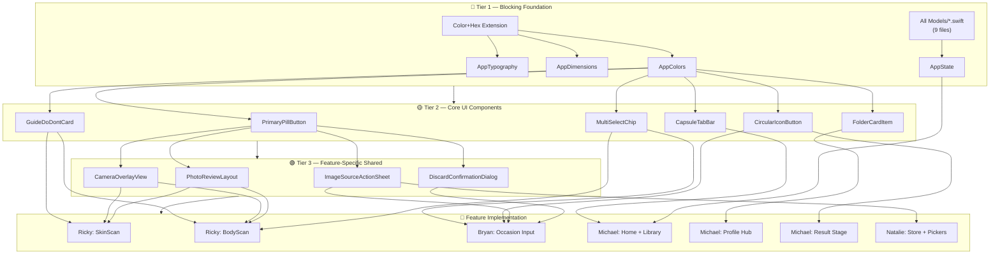

# 🏛️ Personal Wardrobe — Team Architecture & Unified Technical Blueprint

> **Challenge 5 — Apple Developer Academy**  
> **Sprint 1 Goal:** MVP App  
> **Sprint Window:** 22 October – 6 November 2026

---

> [!CAUTION]
> **FOR ALL AI CODING ASSISTANTS (Antigravity, Cursor, Claude Code, GitHub Copilot, ChatGPT, etc.):**
>
> This file is the **Single Source of Truth (SSOT)** for the entire development team.
> You **MUST** strictly follow the data contracts, module boundaries, coding conventions,
> and Swift style rules defined in this document. Deviation will cause merge conflicts,
> architecture drift, and broken cross-feature integrations.
>
> **Before writing any code, read and internalize this entire document.**

---

## Table of Contents

1. [Project Overview & Tech Stack](#1-project-overview--tech-stack)
2. [Swift Coding Rules & Style Guide](#2-swift-coding-rules--style-guide)
3. [Team Feature Ownership & Module Boundaries](#3-team-feature-ownership--module-boundaries)
4. [Directory & File Organization](#4-directory--file-organization)
5. [Canonical Shared Data Contracts (`Models/`)](#5-canonical-shared-data-contracts-models)
6. [Global State & Navigation Coordinator](#6-global-state--navigation-coordinator)
7. [Shared Design Tokens (`Shared/Theme/`)](#7-shared-design-tokens-sharedtheme)
8. [Cross-Feature Integration Contracts](#8-cross-feature-integration-contracts)
9. [Service Protocols & Abstraction Layer](#9-service-protocols--abstraction-layer)
10. [Rules of Engagement for AI Assistants](#10-rules-of-engagement-for-ai-assistants)

---

## 1. Project Overview & Tech Stack

| Aspect | Detail |
| :--- | :--- |
| **Platform** | iOS 18.0+ |
| **Language** | Swift 6 / Swift 5.10 (Strict Concurrency Checking enabled) |
| **UI Framework** | SwiftUI — Declarative, Feature-Driven MVVM |
| **State** | Observation Framework (`@Observable`) + central `AppState` in Environment |
| **Persistence** | SwiftData (`@Model`, `@Relationship`) |
| **Computer Vision** | Apple Vision Framework (`VNDetectHumanBodyPoseRequest`, `VNDetectFaceLandmarksRequest`) |
| **Camera** | AVFoundation (`AVCaptureSession`, Video Data Output for real-time luminance) |
| **On-Device AI** | `llama.cpp` Swift wrapper with local GGUF model weights |
| **Version Control** | Git — default branch `dev`. PRs require ≥ 1 peer review before merge. |

---

## 2. Swift Coding Rules & Style Guide

> [!IMPORTANT]
> Follow the [official Swift API Design Guidelines](https://www.swift.org/documentation/api-design-guidelines/) at all times.
> Every developer and every AI assistant writing code in this repository **must** comply with
> the rules below. Code that violates these rules will be rejected in review.

### 2.1 Language & Style Principles

- **Clarity at the point of use** is the fundamental goal. Every name should make sense when read at the call site, not just at the declaration site.
- Use **expressive, self-documenting names**. Avoid cryptic abbreviations.
- **Prefer value types** (`struct`, `enum`) over `class` unless reference semantics or SwiftData persistence require it.
- Leverage Swift's type system to **catch invalid state at compile time** — use enums with associated values instead of stringly-typed state.
- **No magic numbers.** Put all tunable or configurable values in named constants inside dedicated configuration types or `AppConstants`.

```swift
// ✅ Clear and expressive
func estimateBodyType(from measurements: BodyMeasurements) -> BodyType

// ❌ Unclear and abbreviated
func estBT(m: BodyMeasurements) -> String
```

### 2.2 Naming Conventions

| Symbol Kind | Casing | Examples |
| :--- | :--- | :--- |
| Types: `class`, `struct`, `enum`, `protocol` | `UpperCamelCase` | `SkinScanViewModel`, `BodyType`, `CameraServiceProtocol` |
| Enum cases | `lowerCamelCase` | `.warmSpring`, `.invertedTriangle`, `.longTorso` |
| Functions, methods, variables, properties | `lowerCamelCase` | `capturePhoto()`, `shoulderWidthCm`, `isBookmarked` |
| Constants (`let` at module/type scope) | `lowerCamelCase` | `let maximumLuminanceThreshold = 0.65` |
| Acronyms and initialisms | All-caps or all-lowercase, never mixed | `userID`, `destinationURL`, `htmlBody`, `rgbValue` |

### 2.3 Functions & Methods

- Name functions so they **read like prose at the call site**.
- Include argument labels that **clarify the role** of each parameter.
- Omit the first argument label when the function name already conveys it.
- Use `make` for factory functions — never `get` or `create`.

```swift
// ✅ Reads like prose
func insert(_ garment: GarmentItem, at index: Int)
func evaluateLuminance(from sampleBuffer: CMSampleBuffer) -> LightingStatus
func makeDefaultProfile() -> UserProfile

// ❌ Imperative / unclear role
func getProfile() -> UserProfile
func createGarment(garment: GarmentItem, index: Int)
```

### 2.4 Boolean Naming

All Booleans **must read as yes-or-no assertions**. Use prefixes: `is`, `has`, `can`, `should`, `did`, `needs`.

```swift
var isCapturingPhoto: Bool
var hasCompletedProfileSetup: Bool
var canRetakeScan: Bool
var shouldShowLightingWarning: Bool
var didFinishBodyAnalysis: Bool
var needsCalibration: Bool
```

### 2.5 Variables, Properties & Types

- Stored values should be **nouns** describing what they hold.
- Use `count` — never `num` or `number`.
- Type names are **nouns** (they represent things, not actions).
- Protocol names describing capability use `-able`, `-ible`, or `-ing` suffixes.

```swift
// ✅
var garmentCount: Int
var activeOccasion: OccasionItem?
protocol Scannable { ... }
protocol LightingEvaluating { ... }

// ❌
var numberOfGarments: Int     // use garmentCount
var numItems: Int             // abbreviated and unclear
protocol DoScan { ... }       // verb, not capability noun
```

### 2.6 SwiftUI View Conventions

- Each View file contains **exactly one primary View struct**.
- View files are named identically to the struct: `SkinResultView.swift` contains `struct SkinResultView: View`.
- Extract **reusable subviews** as `private` computed properties or separate child views — never let `body` exceed ~40 lines.
- Never place business logic or data transformation inside the View. Delegate to the ViewModel.

```swift
// ✅ Clean View body
struct SkinResultView: View {
    @State private var viewModel: SkinScanViewModel
    
    var body: some View {
        ScrollView {
            headerSection
            colorWheelSection
            descriptionSection
            nextButton
        }
    }
    
    private var headerSection: some View { ... }
    private var colorWheelSection: some View { ... }
}
```

### 2.7 ViewModel Conventions

- ViewModels are `@Observable` classes (Observation Framework), not `ObservableObject`.
- Naming: `<Feature>ViewModel` — e.g. `SkinScanViewModel`, `BodyScanViewModel`.
- All async work (camera, Vision, SwiftData) uses `async/await`. Never block the main thread.
- Mark main-actor-bound state with `@MainActor` where needed.

```swift
@Observable @MainActor
final class BodyScanViewModel {
    var capturedFrontImage: UIImage?
    var capturedSideImage: UIImage?
    var isAnalyzing: Bool = false
    var analysisResult: BodyType?
    
    private let poseEstimator: BodyPoseEstimatorProtocol
    
    init(poseEstimator: BodyPoseEstimatorProtocol) {
        self.poseEstimator = poseEstimator
    }
    
    func analyzeBodyType() async throws { ... }
}
```

### 2.8 Error Handling

- Define **domain-specific error enums** per service module.
- Propagate errors with `throws` — never silently swallow.
- Present user-facing errors through ViewModel state, not raw alerts in Views.

```swift
enum CameraError: LocalizedError {
    case sessionConfigurationFailed
    case captureDeviceUnavailable
    case photoCaptureFailed(underlying: Error)
    
    var errorDescription: String? {
        switch self {
        case .sessionConfigurationFailed:
            return "Unable to configure the camera session."
        case .captureDeviceUnavailable:
            return "No camera device is available."
        case .photoCaptureFailed(let error):
            return "Photo capture failed: \(error.localizedDescription)"
        }
    }
}
```

### 2.9 File Organization Within a Swift File

Use `// MARK: -` to organize sections consistently across all files:

```swift
import SwiftUI

struct FrontBodyGuideView: View {
    
    // MARK: - Properties
    
    @State private var viewModel: BodyScanViewModel
    @Environment(AppState.self) private var appState
    
    // MARK: - Body
    
    var body: some View { ... }
    
    // MARK: - Subviews
    
    private var instructionGrid: some View { ... }
    private var actionButton: some View { ... }
    
    // MARK: - Actions
    
    private func handleTakePicture() { ... }
}

// MARK: - Preview

#Preview {
    FrontBodyGuideView(viewModel: .mock())
}
```

### 2.10 Access Control

- Default to the **most restrictive access level** that still compiles.
- Mark View subviews and helper methods as `private`.
- Mark ViewModel internals as `private` — expose only what the View needs.
- Shared models in `Models/` remain `internal` (default) for cross-module access.

### 2.11 Concurrency & Threading

- Use **Swift Concurrency** (`async/await`, `Task`, `AsyncStream`) for all asynchronous operations.
- Mark UI-bound ViewModels with `@MainActor`.
- Never use `DispatchQueue.main.async` in new code — use `@MainActor` instead.
- Camera frame processing may use a dedicated `Actor` for thread safety.

---

## 3. Team Feature Ownership & Module Boundaries

> [!WARNING]
> **Module Boundary Rule:** Never modify files inside another developer's owned directories
> without explicit team agreement. If cross-feature work is needed, communicate through
> the shared contracts in `Models/`, `Services/Protocols/`, and `App/AppState.swift`.

| Team Member | Jira Story | Owned Directories | Responsibilities |
| :--- | :--- | :--- | :--- |
| **Ricky Jonathan** | `C5-2` | `Features/SkinScan/`<br>`Features/BodyScan/`<br>`Services/Camera/`<br>`Services/Vision/` | Face scan (lighting check, color season extraction).<br>Front & side body scan (camera guides, pose estimation).<br>Physical metrics input form.<br>Body type & torso balance calculation. |
| **Bryan Samuel** | `C5-3` | `Features/Occasion/Input/`<br>`Services/AI/Prompts/` | Occasion form (title, date, dresscode, reference).<br>Vision chips grid (16 preset + "Other").<br>Data processing pipeline.<br>LLM prompt engineering & fine-tuning. |
| **Michael David Sin** | `C5-1`<br>`C5-4`<br>`C5-31–46` | `Features/Home/`<br>`Features/Library/`<br>`Features/Occasion/Result/`<br>`Features/Profile/`<br>`Services/AI/Engine/`<br>`Shared/Components/` | App shell (Home, Library, Profile Hub tabs).<br>Interactive avatar result stage.<br>Flanking garment cards & 5-look carousel.<br>3-Fits compliance badges & rationale drawer.<br>On-device LLaMA engine integration. |
| **Natalie Grace** | `C5-5`<br>`C5-11`<br>`C5-16–18` | `Features/Store/`<br>`Shared/Pickers/` | Image source action sheet (Camera, Photos, Saved).<br>In-app image retrieval from local storage.<br>"Where to Buy" e-commerce store links. |
| **Nicole Clarence** | `C5-20`<br>`C5-44` | `Shared/Theme/`<br>`Resources/` | Global color palette, typography, spacing tokens.<br>Glassmorphism effects, shadows, corner radii.<br>Final Hi-Fi polish to match Sketch designs. |

---

## 4. Directory & File Organization

The project uses Xcode 16 `PBXFileSystemSynchronizedRootGroup`. Files added to the `Challenge-5/` directory are automatically recognized by Xcode.

```
Challenge-5/
├── MyApp.swift                                    # @main entry + SwiftData ModelContainer
├── ContentView.swift                              # Root coordinator / tab router
│
├── App/                                           # Global State & Constants
│   ├── AppState.swift                             # NavigationPath, sheets, active session
│   └── AppConstants.swift                         # Named configuration values (no magic numbers)
│
├── Features/                                      # Feature-Driven Modules (MVVM)
│   │
│   ├── Onboarding/                                # ── Stack 16 ──
│   │   ├── Views/
│   │   │   └── WelcomeView.swift                  # "Welcome to your Personal Wardrobe" + Start Now
│   │   └── ViewModels/
│   │       └── OnboardingViewModel.swift
│   │
│   ├── Home/                                      # ── Stack 12, 13 ── (Michael)
│   │   ├── Views/
│   │   │   ├── OccasionsHomeView.swift            # Empty state + floating (+) button
│   │   │   ├── OccasionsHistoryView.swift         # Past occasions list (clock icon)
│   │   │   └── ProfilePromptModal.swift           # "Set Up Your Profile" pop-up
│   │   └── ViewModels/
│   │       └── HomeViewModel.swift
│   │
│   ├── Library/                                   # ── Stack 12, 13 ── (Michael)
│   │   ├── Views/
│   │   │   └── LibraryView.swift                  # Saved/bookmarked look collection
│   │   └── ViewModels/
│   │       └── LibraryViewModel.swift
│   │
│   ├── Profile/                                   # ── Stack 12, 21 ── (Michael)
│   │   ├── Views/
│   │   │   ├── ProfileHubView.swift               # 4 folder cards hub
│   │   │   └── Components/
│   │   │       └── FolderCardItem.swift           # Glassmorphic tab-folder card
│   │   └── ViewModels/
│   │       └── ProfileViewModel.swift
│   │
│   ├── SkinScan/                                  # ── Stack 19 ── (Ricky)
│   │   ├── Views/
│   │   │   ├── SkinScanGuideView.swift            # Do & Don't face scan guide
│   │   │   ├── FaceCameraView.swift               # Live camera + green dot lighting check
│   │   │   ├── FaceReviewView.swift               # Photo checklist + discard modal
│   │   │   └── SkinResultView.swift               # Color Season wheel + undertone text
│   │   └── ViewModels/
│   │       └── SkinScanViewModel.swift
│   │
│   ├── BodyScan/                                  # ── Stack 20 ── (Ricky)
│   │   ├── Views/
│   │   │   ├── FrontBodyGuideView.swift           # Front body Do & Don't
│   │   │   ├── FrontBodyCameraView.swift          # Camera + alignment guides
│   │   │   ├── FrontBodyReviewView.swift          # Review front capture
│   │   │   ├── SideBodyGuideView.swift            # Side body Do & Don't
│   │   │   ├── SideBodyCameraView.swift           # Camera + vertical alignment
│   │   │   ├── SideBodyReviewView.swift           # Review side capture
│   │   │   ├── PhysicalMetricsInputView.swift     # Age, Weight, Height, Size S–XXL
│   │   │   └── BodyAnalysisResultView.swift       # Body type visual + torso balance
│   │   └── ViewModels/
│   │       └── BodyScanViewModel.swift
│   │
│   ├── Occasion/                                  # ── Stack 14 ── (Bryan & Michael)
│   │   ├── Input/                                 # (Bryan)
│   │   │   ├── Views/
│   │   │   │   ├── OccasionFormSheet.swift        # Modal: title, date, dresscode, ref, chips
│   │   │   │   ├── DatePickerModalView.swift      # Calendar popover
│   │   │   │   └── VisionChipsGridView.swift      # 16 preset chips + "Other"
│   │   │   └── ViewModels/
│   │   │       └── OccasionInputViewModel.swift
│   │   └── Result/                                # (Michael)
│   │       ├── Views/
│   │       │   ├── ResultStageView.swift          # Avatar stage + 5-look carousel
│   │       │   ├── FlankingGarmentCard.swift      # Outer / Top / Bottom cards
│   │       │   ├── FitsIndicatorBadges.swift      # Body Shape, Color, Torso badges
│   │       │   └── FitRationaleDrawer.swift       # AI explanation bottom sheet
│   │       └── ViewModels/
│   │           └── ResultStageViewModel.swift
│   │
│   └── Store/                                     # ── Stack 14 ── (Natalie)
│       ├── Views/
│       │   └── WhereToBuySheet.swift              # E-commerce store links bottom sheet
│       └── ViewModels/
│           └── StoreViewModel.swift
│
├── Models/                                        # CANONICAL SHARED DATA CONTRACTS
│   ├── UserProfile.swift                          # SwiftData @Model — root user profile
│   ├── BodyMeasurements.swift                    # Struct — shoulder, bust, waist, hip, height
│   ├── BodyType.swift                             # Enum — 5 primary body shapes
│   ├── TorsoBalance.swift                         # Enum — torso-to-leg ratio
│   ├── ColorSeason.swift                          # Enum — 8 personal color seasons
│   ├── StyleCharacter.swift                       # Enum — fashion personality
│   ├── OccasionItem.swift                         # SwiftData @Model — occasion entity
│   ├── OutfitLook.swift                           # SwiftData @Model — generated look
│   └── GarmentItem.swift                          # SwiftData @Model — single garment
│
├── Services/                                      # Protocols + Native Implementations
│   ├── Protocols/
│   │   ├── CameraServiceProtocol.swift
│   │   ├── LightingAnalyzerProtocol.swift
│   │   ├── BodyPoseEstimatorProtocol.swift
│   │   ├── SkinColorAnalyzerProtocol.swift
│   │   └── RecommendationEngineProtocol.swift
│   ├── Camera/
│   │   ├── CameraService.swift                    # AVFoundation session management
│   │   └── LightingAnalyzer.swift                 # Real-time luminance / EV analysis
│   ├── Vision/
│   │   ├── BodyPoseEstimator.swift                # Joint detection + body ratio calculation
│   │   └── SkinColorAnalyzer.swift                # Pixel sampling + undertone classification
│   ├── AI/
│   │   ├── Engine/
│   │   │   └── LLaMAEngine.swift                  # llama.cpp on-device wrapper
│   │   └── Prompts/
│   │       └── PromptTemplates.swift              # System prompt builder for 5-look generation
│   └── Storage/
│       └── SwiftDataStack.swift                   # ModelContainer + query helpers
│
├── Shared/                                        # Reusable Design System
│   ├── Theme/
│   │   ├── AppColors.swift                        # Brand color palette
│   │   ├── AppTypography.swift                    # Font styles
│   │   └── AppDimensions.swift                    # Spacing, radii, padding
│   ├── Components/
│   │   ├── PrimaryPillButton.swift                # Blue rounded action button
│   │   ├── CapsuleTabBar.swift                    # Floating bottom tab (Occasion | Library)
│   │   ├── CircularIconButton.swift               # Header icons (profile, history, close)
│   │   ├── GuideDoDontCard.swift                  # Do ✅ / Don't ❌ instruction card
│   │   └── MultiSelectChip.swift                  # Selectable vision chip
│   ├── Pickers/
│   │   └── ImageSourceActionSheet.swift           # Camera / Photos / Library action menu
│   └── Extensions/
│       ├── Color+Hex.swift                        # Color(hex:) initializer
│       └── View+Modifiers.swift                   # Common view modifiers
│
└── Resources/
    ├── Assets.xcassets                            # Colors, icons, silhouettes, mannequins
    └── Preview Content/                           # Mock data for #Preview
```

---

## 5. Canonical Shared Data Contracts (`Models/`)

> [!IMPORTANT]
> **RULE FOR ALL AI ASSISTANTS AND DEVELOPERS:**
>
> 1. **Never** redefine or create duplicate versions of these types in feature subfolders.
> 2. **Always** import and use these shared models from the `Models/` group.
> 3. When adding a new model, place it here and update this document.

### 5.1 User Physical & Color Profile

```swift
// Models/UserProfile.swift
import Foundation
import SwiftData

@Model
final class UserProfile {
    @Attribute(.unique) var id: UUID = UUID()
    var createdAt: Date = Date()
    var updatedAt: Date = Date()
    
    // Body & Color Profiling (Ricky — C5-2)
    var colorSeason: ColorSeason?
    var bodyType: BodyType?
    var torsoBalance: TorsoBalance?
    var measurements: BodyMeasurements?
    var character: StyleCharacter?
    
    var hasCompletedProfileSetup: Bool {
        colorSeason != nil && bodyType != nil && measurements != nil
    }
    
    // Captured photos stored as compressed JPEG data
    @Attribute(.externalStorage) var facePhotoData: Data?
    @Attribute(.externalStorage) var frontBodyPhotoData: Data?
    @Attribute(.externalStorage) var sideBodyPhotoData: Data?
    
    init(
        colorSeason: ColorSeason? = nil,
        bodyType: BodyType? = nil,
        torsoBalance: TorsoBalance? = nil,
        measurements: BodyMeasurements? = nil,
        character: StyleCharacter? = nil
    ) {
        self.colorSeason = colorSeason
        self.bodyType = bodyType
        self.torsoBalance = torsoBalance
        self.measurements = measurements
        self.character = character
    }
}
```

```swift
// Models/BodyMeasurements.swift
struct BodyMeasurements: Codable, Equatable, Hashable {
    var age: Int
    var weightKg: Double
    var heightCm: Double
    var usualSize: ClothingSize
    
    // Vision framework estimated values (editable by user)
    var shoulderWidthCm: Double?
    var bustCircumferenceCm: Double?
    var waistCircumferenceCm: Double?
    var hipCircumferenceCm: Double?
}

enum ClothingSize: String, Codable, CaseIterable, Identifiable {
    case s = "S"
    case m = "M"
    case l = "L"
    case xl = "XL"
    case xxl = "XXL"
    
    var id: String { rawValue }
}
```

```swift
// Models/BodyType.swift
enum BodyType: String, Codable, CaseIterable, Identifiable {
    case invertedTriangle = "Inverted Triangle"
    case hourglass = "Hourglass"
    case rectangle = "Rectangle"
    case pear = "Pear"
    case apple = "Apple"
    
    var id: String { rawValue }
}

// Models/TorsoBalance.swift
enum TorsoBalance: String, Codable, CaseIterable, Identifiable {
    case longTorso = "Long Torso"
    case balanced = "Balanced"
    case shortTorso = "Short Torso"
    
    var id: String { rawValue }
}

// Models/ColorSeason.swift
enum ColorSeason: String, Codable, CaseIterable, Identifiable {
    case warmSpring = "Warm Spring"
    case lightSpring = "Light Spring"
    case clearSpring = "Clear Spring"
    case coolSummer = "Cool Summer"
    case warmAutumn = "Warm Autumn"
    case deepAutumn = "Deep Autumn"
    case coolWinter = "Cool Winter"
    case deepWinter = "Deep Winter"
    
    var id: String { rawValue }
}

// Models/StyleCharacter.swift
enum StyleCharacter: String, Codable, CaseIterable, Identifiable {
    case romantic = "Romantic"
    case classic = "Classic"
    case casual = "Casual"
    case dramatic = "Dramatic"
    case creative = "Creative"
    case minimalist = "Minimalist"
    
    var id: String { rawValue }
}
```

### 5.2 Occasion & Recommendation

```swift
// Models/OccasionItem.swift
import Foundation
import SwiftData

@Model
final class OccasionItem {
    @Attribute(.unique) var id: UUID = UUID()
    var title: String
    var date: Date
    var dresscode: String
    @Attribute(.externalStorage) var referenceImageData: Data?
    var visionKeywords: [String]
    var customNote: String?
    var createdAt: Date = Date()
    var isCompleted: Bool = false
    
    @Relationship(deleteRule: .cascade)
    var generatedLooks: [OutfitLook] = []
    
    var isUpcoming: Bool { date > Date() }
    
    init(
        title: String,
        date: Date,
        dresscode: String,
        referenceImageData: Data? = nil,
        visionKeywords: [String] = [],
        customNote: String? = nil
    ) {
        self.title = title
        self.date = date
        self.dresscode = dresscode
        self.referenceImageData = referenceImageData
        self.visionKeywords = visionKeywords
        self.customNote = customNote
    }
}
```

```swift
// Models/OutfitLook.swift
import Foundation
import SwiftData

@Model
final class OutfitLook {
    @Attribute(.unique) var id: UUID = UUID()
    var lookIndex: Int                      // 0..4 for 5 AI-generated looks
    var isBookmarked: Bool = false
    
    // 3-Fits compliance scores (0.0 to 1.0)
    var bodyShapeScore: Double
    var colorHarmonyScore: Double
    var torsoBalanceScore: Double
    var fitRationale: String
    
    @Relationship(deleteRule: .cascade)
    var garments: [GarmentItem] = []
    
    init(
        lookIndex: Int,
        bodyShapeScore: Double = 0.0,
        colorHarmonyScore: Double = 0.0,
        torsoBalanceScore: Double = 0.0,
        fitRationale: String = "",
        isBookmarked: Bool = false
    ) {
        self.lookIndex = lookIndex
        self.bodyShapeScore = bodyShapeScore
        self.colorHarmonyScore = colorHarmonyScore
        self.torsoBalanceScore = torsoBalanceScore
        self.fitRationale = fitRationale
        self.isBookmarked = isBookmarked
    }
}
```

```swift
// Models/GarmentItem.swift
import Foundation
import SwiftData

@Model
final class GarmentItem {
    @Attribute(.unique) var id: UUID = UUID()
    var category: GarmentCategory
    var name: String                        // e.g. "Skinny Jeans"
    var material: String                    // e.g. "French Terry Cotton"
    var colorName: String                   // e.g. "Burgundy red"
    var hexColor: String                    // e.g. "#800020"
    var purchaseURLString: String?          // deep link to e-commerce store
    
    init(
        category: GarmentCategory,
        name: String,
        material: String,
        colorName: String,
        hexColor: String,
        purchaseURLString: String? = nil
    ) {
        self.category = category
        self.name = name
        self.material = material
        self.colorName = colorName
        self.hexColor = hexColor
        self.purchaseURLString = purchaseURLString
    }
}

enum GarmentCategory: String, Codable, CaseIterable, Identifiable {
    case outer = "Outer"
    case top = "Top"
    case bottom = "Bottom"
    case shoes = "Shoes"
    case accessory = "Accessory"
    
    var id: String { rawValue }
}
```

---

## 6. Global State & Navigation Coordinator

All tab switches, full-screen covers, and sheet presentations are coordinated through
a single `AppState` object injected via the SwiftUI Environment. Any feature module can
read and write to `AppState` to trigger navigation across module boundaries.

```swift
// App/AppState.swift
import SwiftUI

@Observable
final class AppState {
    
    // MARK: - Tab Navigation
    
    var selectedTab: AppTab = .occasions
    
    enum AppTab: Int, CaseIterable {
        case occasions = 0
        case library = 1
    }
    
    // MARK: - Navigation Stack
    
    var navigationPath = NavigationPath()
    
    // MARK: - Global Sheet & Modal State
    
    var isShowingProfileHub: Bool = false
    var isShowingProfileSetupFlow: Bool = false      // Triggers Ricky's SkinScan → BodyScan flow
    var isShowingNewOccasionSheet: Bool = false       // Triggers Bryan's OccasionFormSheet
    var isShowingWhereToBuySheet: Bool = false        // Triggers Natalie's WhereToBuySheet
    
    // MARK: - Active Data in Scope
    
    var activeOccasion: OccasionItem?
    var selectedGarmentForPurchase: GarmentItem?
}
```

---

## 7. Shared Design Tokens (`Shared/Theme/`)

> [!WARNING]
> All developers and AI assistants **MUST** use these tokens.
> Do not hardcode color hex strings, font sizes, or padding values in feature code.

```swift
// Shared/Theme/AppColors.swift
import SwiftUI

enum AppColors {
    // Backgrounds
    static let canvasBackground = Color(hex: "#FAF8F5")         // Warm creamy white
    static let cardBackground = Color.white
    static let glassmorphicFill = Color.white.opacity(0.85)
    
    // Brand & Typography
    static let espressoTitle = Color(hex: "#2C1E18")            // Display serif titles
    static let bodyText = Color(hex: "#3C3C43")                 // Primary body text
    static let mutedCaption = Color(hex: "#7A726D")             // Secondary / placeholder
    
    // Actions
    static let primaryBlue = Color(hex: "#007AFF")              // CTA buttons, active chips
    static let destructiveRed = Color(hex: "#FF3B30")           // Discard / delete
    
    // Pastel Accents (Profile Folder Cards)
    static let pastelPeach = Color(hex: "#F9D5A7")
    static let pastelSage = Color(hex: "#B8C5B3")
    static let pastelGold = Color(hex: "#F4C47A")
    static let pastelRose = Color(hex: "#F2C4C4")
    
    // Camera Status Indicators
    static let lightingOptimal = Color(hex: "#34C759")          // Green dot
    static let lightingWarning = Color(hex: "#FF9500")          // Orange dot
}
```

```swift
// Shared/Theme/AppTypography.swift
import SwiftUI

enum AppTypography {
    static let displayTitle = Font.system(.largeTitle, design: .serif, weight: .bold)
    static let screenHeader = Font.system(size: 28, weight: .bold, design: .serif)
    static let sectionHeader = Font.system(size: 20, weight: .semibold)
    static let cardHeadline = Font.system(size: 17, weight: .semibold)
    static let bodyRegular = Font.system(size: 15, weight: .regular)
    static let caption = Font.system(size: 13, weight: .regular)
    static let buttonLabel = Font.system(size: 16, weight: .semibold)
    static let chipLabel = Font.system(size: 14, weight: .medium)
}
```

```swift
// Shared/Theme/AppDimensions.swift
import Foundation

enum AppDimensions {
    // Corner Radii
    static let buttonCornerRadius: CGFloat = 28
    static let cardCornerRadius: CGFloat = 20
    static let folderTabRadius: CGFloat = 16
    static let chipCornerRadius: CGFloat = 12
    
    // Spacing & Padding
    static let screenHorizontalPadding: CGFloat = 20
    static let cardInternalPadding: CGFloat = 16
    static let sectionSpacing: CGFloat = 24
    static let elementSpacing: CGFloat = 12
    
    // Sizes
    static let tabBarHeight: CGFloat = 48
    static let floatingButtonSize: CGFloat = 56
    static let circularIconSize: CGFloat = 36
}
```

---

## 8. Cross-Feature Integration Contracts

These contracts define **how modules talk to each other** without importing each other's
internal implementation files. Every AI assistant must use these exact interfaces.

### 8.1 Ricky → Bryan: Profile feeds into Recommendation

Bryan's AI prompt engine requires the completed `UserProfile` from Ricky's profiling flow:

```swift
// Used by Bryan's PromptTemplates to build the recommendation request
struct RecommendationPayload {
    let userProfile: UserProfile        // Filled by Ricky's SkinScan + BodyScan flow
    let occasion: OccasionItem          // Filled by Bryan's OccasionFormSheet
}
```

### 8.2 Michael → Natalie: Garment card triggers store lookup

When a user taps the 🛒 icon on a flanking garment card in Michael's `ResultStageView`:

```swift
// In ResultStageView (Michael's code):
appState.selectedGarmentForPurchase = tappedGarment
appState.isShowingWhereToBuySheet = true

// Natalie's WhereToBuySheet reads from:
// appState.selectedGarmentForPurchase
```

### 8.3 Home → Ricky: Profile setup prompt triggers profiling flow

When an un-profiled user taps "Let's Get Started" in Michael's `ProfilePromptModal`:

```swift
// In ProfilePromptModal (Michael's code):
appState.isShowingProfileSetupFlow = true

// ContentView (root) presents Ricky's SkinScanGuideView as a fullScreenCover
```

---

## 9. Service Protocols & Abstraction Layer

To enable SwiftUI `#Preview` without live camera sessions or heavy ML models, all services
**MUST** conform to protocols. Provide mock implementations for previews and tests.

```swift
// Services/Protocols/CameraServiceProtocol.swift
import UIKit
import AVFoundation

protocol CameraServiceProtocol: AnyObject, Sendable {
    var isRunning: Bool { get }
    func startSession() async throws
    func stopSession()
    func capturePhoto() async throws -> UIImage
    func switchCamera() async throws
}
```

```swift
// Services/Protocols/LightingAnalyzerProtocol.swift
import AVFoundation

enum LightingStatus: String, Sendable {
    case optimal            // Green indicator — proceed with capture
    case tooDark            // Orange indicator — warn user
    case tooBright          // Orange indicator — warn user
    case backlit            // Silhouette detected — prompt repositioning
}

protocol LightingAnalyzerProtocol: Sendable {
    func evaluateLuminance(from sampleBuffer: CMSampleBuffer) -> LightingStatus
}
```

```swift
// Services/Protocols/BodyPoseEstimatorProtocol.swift
import UIKit

struct BodyLandmarks: Sendable {
    let shoulderWidth: CGFloat
    let bustWidth: CGFloat
    let waistWidth: CGFloat
    let hipWidth: CGFloat
    let torsoLength: CGFloat
    let legLength: CGFloat
}

protocol BodyPoseEstimatorProtocol: Sendable {
    func estimateLandmarks(from image: UIImage) async throws -> BodyLandmarks
    func classifyBodyType(from landmarks: BodyLandmarks) -> BodyType
    func classifyTorsoBalance(from landmarks: BodyLandmarks) -> TorsoBalance
}
```

```swift
// Services/Protocols/SkinColorAnalyzerProtocol.swift
import UIKit

protocol SkinColorAnalyzerProtocol: Sendable {
    func analyzeSkinTone(from faceImage: UIImage) async throws -> ColorSeason
}
```

```swift
// Services/Protocols/RecommendationEngineProtocol.swift

protocol RecommendationEngineProtocol: Sendable {
    func generateLooks(
        for payload: RecommendationPayload,
        lookCount: Int
    ) async throws -> [OutfitLook]
}
```

---

## 10. Rules of Engagement for AI Assistants

> [!CAUTION]
> Every AI coding assistant working in this repository **MUST** follow these rules.
> These rules exist to prevent cross-developer conflicts and maintain architecture integrity
> across 5 concurrent workstreams.

### 10.1 Module Boundary Rules

1. **Never modify files inside another developer's owned directories** without explicit
   team agreement. If you are implementing BodyScan (Ricky), do not touch
   `OccasionFormSheet.swift` (Bryan) or `ResultStageView.swift` (Michael).

2. **Cross-feature communication happens only through:**
   - Shared models in `Models/`
   - Service protocols in `Services/Protocols/`
   - `App/AppState.swift` for navigation triggers

### 10.2 Data Contract Rules

3. **Never create duplicate model types.** Before defining any `struct`, `enum`, or `class`,
   verify whether it already exists in `Challenge-5/Models/`.

4. **Never add properties to shared models without updating this document.** If you need a
   new field on `UserProfile` or `OccasionItem`, add it here first, then implement.

### 10.3 Code Quality Rules

5. **Always supply `#Preview` with mock data** conforming to the shared models so the
   entire team can visually inspect screens in Xcode Canvas without running the full app.

6. **Use Swift Concurrency (`async/await`)** for all camera, Vision, AI, and storage
   operations. Never block the main thread.

7. **Follow the naming conventions in Section 2.** Booleans start with `is`/`has`/`can`/`should`.
   Factory methods use `make`. No abbreviations. No magic numbers.

8. **Preserve all existing comments and docstrings** in files you are editing. Never
   silently remove documentation written by another team member.

9. **Use `AppColors`, `AppTypography`, and `AppDimensions`** from `Shared/Theme/`. Never
   hardcode hex color strings, font sizes, or padding values in feature Views.

10. **Mark ViewModels with `@Observable @MainActor`**. Use protocol-based dependency
    injection so previews and tests can substitute mock services.

### 10.4 Git & Collaboration Rules

11. **Branch naming:** `feature/<jira-key>-<short-description>` (e.g., `feature/C5-2-body-scan`).

12. **Commit messages:** `<type>: <short description>` where type is one of
    `feat`, `fix`, `refactor`, `style`, `docs`, `test`, `chore`.

13. **Pull requests** target `dev` branch and require ≥ 1 reviewer before merge.

14. **No force pushes** to `dev` or `main`.

---

## 11. Reusable Components Catalog & Build Priority

> [!WARNING]
> **No reusable components exist in the codebase yet.** All `Shared/Components/`,
> `Shared/Theme/`, `Shared/Extensions/`, `Models/`, and `Services/` directories are empty.
>
> The components below **MUST** be implemented before any feature work begins.
> Building features without these shared foundations will cause duplicate code,
> visual inconsistency, and merge conflicts across 5 concurrent workstreams.

### 11.1 Component–Screen Usage Matrix

Every component listed here appears in **2 or more screens** owned by **different developers**.
This is why they must be shared — not reimplemented per feature.

| Component | Used By Developers | Screens Where It Appears | Usage Count |
| :--- | :--- | :--- | :---: |
| `AppColors` | **All 5** | Every screen | ∞ |
| `AppTypography` | **All 5** | Every screen | ∞ |
| `AppDimensions` | **All 5** | Every screen | ∞ |
| `Color+Hex` | **All 5** | Required by `AppColors` + `GarmentItem.hexColor` | ∞ |
| `PrimaryPillButton` | Ricky, Bryan, Michael | WelcomeView, SkinScanGuide, FrontBodyGuide, SideBodyGuide, PhysicalMetrics, SkinResult, ProfilePromptModal | **7+** |
| `GuideDoDontCard` | Ricky | SkinScanGuide (6), FrontBodyGuide (6), SideBodyGuide (6) | **18** |
| `CircularIconButton` | Michael, Bryan | OccasionsHome (2), Library (1), OccasionForm (2), ResultStage (3) | **8** |
| `MultiSelectChip` | Bryan, Ricky | VisionChipsGrid (16), PhysicalMetrics size picker (5) | **21** |
| `CapsuleTabBar` | Michael | OccasionsHome, LibraryView | **2** |
| `FolderCardItem` | Michael | ProfileHubView (4 cards) | **4** |
| `PhotoReviewLayout` | Ricky | FaceReview, FrontBodyReview, SideBodyReview | **3** |
| `CameraOverlayView` | Ricky | FaceCamera, FrontBodyCamera, SideBodyCamera | **3** |
| `ImageSourceActionSheet` | Natalie, Bryan | OccasionFormSheet reference picker | **1+** |
| `DiscardConfirmationDialog` | Ricky, Bryan | FaceReview discard, OccasionForm dismiss | **2** |

### 11.2 Three-Tier Build Priority

#### 🔴 Tier 1 — Blocking Foundation (MUST complete before ANY feature work)

These are the absolute minimum files that every developer and every AI assistant depends on.
Without these, no View can be built, no model can be instantiated, and no navigation can occur.

| # | Component | File Path | Why It Blocks |
|---|-----------|-----------|---------------|
| 1 | `Color+Hex` extension | `Shared/Extensions/Color+Hex.swift` | `AppColors` cannot compile without it |
| 2 | `AppColors` | `Shared/Theme/AppColors.swift` | Every View references brand colors |
| 3 | `AppTypography` | `Shared/Theme/AppTypography.swift` | Every View references font styles |
| 4 | `AppDimensions` | `Shared/Theme/AppDimensions.swift` | Every View references spacing/radii |
| 5 | All `Models/*.swift` | `Models/` (9 files) | Every ViewModel and Service depends on shared types |
| 6 | `AppState` | `App/AppState.swift` | Root coordinator — tab navigation, sheet triggers |

**Estimated effort:** ~2–3 hours.  
**Suggested PIC:** Michael David Sin (`C5-27` Setup folders ✅, `C5-28` Make shared components).

#### 🟡 Tier 2 — Core UI Components (MUST complete before implementing Views)

These are the visual building blocks used across multiple features. If a developer starts
building Views without these, they will either create duplicates or use inconsistent styling.

| # | Component | File Path | Why It's Shared |
|---|-----------|-----------|-----------------|
| 7 | `PrimaryPillButton` | `Shared/Components/PrimaryPillButton.swift` | Used in 7+ screens by 3 developers |
| 8 | `CircularIconButton` | `Shared/Components/CircularIconButton.swift` | Used in 8 header positions by 2 developers |
| 9 | `GuideDoDontCard` | `Shared/Components/GuideDoDontCard.swift` | Used 18 times in Ricky's 3 guide screens |
| 10 | `MultiSelectChip` | `Shared/Components/MultiSelectChip.swift` | Used 21 times by Bryan (16 chips) + Ricky (5 sizes) |
| 11 | `CapsuleTabBar` | `Shared/Components/CapsuleTabBar.swift` | Main app navigation — used in 2 primary tabs |
| 12 | `FolderCardItem` | `Features/Profile/Views/Components/FolderCardItem.swift` | Profile hub — 4 folder cards |

**Estimated effort:** ~3–4 hours.  
**Suggested PIC:** Michael (`C5-28`) + Nicole (design token alignment).

#### 🟢 Tier 3 — Feature-Specific Shared (Can be built in parallel with features)

These components are shared within a single developer's feature area. They can be built
at the same time as the feature Views that use them.

| # | Component | File Path | Why It's Shared |
|---|-----------|-----------|-----------------|
| 13 | `PhotoReviewLayout` | `Shared/Components/PhotoReviewLayout.swift` | Identical layout in 3 review screens (Ricky) |
| 14 | `CameraOverlayView` | `Shared/Components/CameraOverlayView.swift` | Grid overlay + lighting dot in 3 camera screens (Ricky) |
| 15 | `ImageSourceActionSheet` | `Shared/Pickers/ImageSourceActionSheet.swift` | Camera/Photos/Library menu (Natalie + Bryan) |
| 16 | `DiscardConfirmationDialog` | `Shared/Components/DiscardConfirmationDialog.swift` | Discard prompt in review + form dismiss (Ricky + Bryan) |

**Estimated effort:** ~2 hours.  
**Suggested PIC:** Each developer builds what they need first; Ricky for #13–14, Natalie for #15.

### 11.3 Build Order Dependency Flow



### 11.4 Sprint Action Plan

#### Day 1 — 23 Oktober (Today)
| Time | Task | PIC | Jira |
|------|------|-----|------|
| ✅ Done | GitHub setup & branch rules | Michael | `C5-22–25` |
| ✅ Done | Setup folder structure | Michael | `C5-27` |
| Afternoon | 🔴 **Tier 1:** `Color+Hex`, `AppColors`, `AppTypography`, `AppDimensions` | **Michael + Nicole** | `C5-28` |
| Afternoon | 🔴 **Tier 1:** All `Models/*.swift` (9 files), `AppState` | **Michael** | `C5-28` |

#### Day 2 — 24 Oktober
| Time | Task | PIC | Jira |
|------|------|-----|------|
| Morning | 🟡 **Tier 2:** `PrimaryPillButton`, `CircularIconButton`, `MultiSelectChip` | **Michael** | `C5-28` |
| Morning | 🟡 **Tier 2:** `CapsuleTabBar`, `GuideDoDontCard` | **Michael + Nicole** | `C5-28` |
| Afternoon | All devs pull `dev` and begin scaffolding their feature Views | **Everyone** | — |

#### Day 3+ — 25 Oktober onwards
| Task | PIC |
|------|-----|
| 🟢 `PhotoReviewLayout`, `CameraOverlayView`, `DiscardConfirmationDialog` → then SkinScan & BodyScan Views | **Ricky** |
| 🟢 `ImageSourceActionSheet` → then OccasionFormSheet, VisionChipsGrid, DatePicker | **Bryan + Natalie** |
| Home, Library, ProfileHub, FolderCardItem → then ResultStage scaffold | **Michael** |
| Final Hi-Fi token polish across all components | **Nicole** |

### 11.5 Component Implementation Specifications

Below are the exact SwiftUI implementations for each shared component. All developers
and AI assistants **MUST** use these — do not create alternative versions.

#### 11.5.1 `Color+Hex` Extension

```swift
// Shared/Extensions/Color+Hex.swift
import SwiftUI

extension Color {
    init(hex: String) {
        let hex = hex.trimmingCharacters(in: CharacterSet.alphanumerics.inverted)
        var int: UInt64 = 0
        Scanner(string: hex).scanHexInt64(&int)
        let a, r, g, b: UInt64
        switch hex.count {
        case 3:
            (a, r, g, b) = (255, (int >> 8) * 17, (int >> 4 & 0xF) * 17, (int & 0xF) * 17)
        case 6:
            (a, r, g, b) = (255, int >> 16, int >> 8 & 0xFF, int & 0xFF)
        case 8:
            (a, r, g, b) = (int >> 24, int >> 16 & 0xFF, int >> 8 & 0xFF, int & 0xFF)
        default:
            (a, r, g, b) = (255, 0, 0, 0)
        }
        self.init(
            .sRGB,
            red: Double(r) / 255,
            green: Double(g) / 255,
            blue: Double(b) / 255,
            opacity: Double(a) / 255
        )
    }
}
```

#### 11.5.2 `PrimaryPillButton`

The standard blue action button used across the entire app. Supports enabled/disabled state.

```swift
// Shared/Components/PrimaryPillButton.swift
import SwiftUI

struct PrimaryPillButton: View {
    
    let title: String
    var isEnabled: Bool = true
    let action: () -> Void
    
    var body: some View {
        Button(action: action) {
            Text(title)
                .font(AppTypography.buttonLabel)
                .foregroundStyle(.white)
                .frame(maxWidth: .infinity)
                .padding(.vertical, 16)
                .background(isEnabled ? AppColors.primaryBlue : AppColors.primaryBlue.opacity(0.4))
                .clipShape(Capsule())
        }
        .disabled(!isEnabled)
    }
}

#Preview {
    VStack(spacing: 20) {
        PrimaryPillButton(title: "Start Now") { }
        PrimaryPillButton(title: "Next", isEnabled: false) { }
    }
    .padding()
}
```

#### 11.5.3 `CircularIconButton`

Header icon buttons for navigation, dismiss, profile, and actions.

```swift
// Shared/Components/CircularIconButton.swift
import SwiftUI

struct CircularIconButton: View {
    
    let systemName: String
    var isFilled: Bool = false
    let action: () -> Void
    
    var body: some View {
        Button(action: action) {
            Image(systemName: systemName)
                .font(.system(size: 16, weight: .medium))
                .foregroundStyle(AppColors.bodyText)
                .frame(
                    width: AppDimensions.circularIconSize,
                    height: AppDimensions.circularIconSize
                )
                .background(AppColors.cardBackground)
                .clipShape(Circle())
                .shadow(color: .black.opacity(0.06), radius: 4, y: 2)
        }
    }
}

#Preview {
    HStack(spacing: 12) {
        CircularIconButton(systemName: "clock.arrow.circlepath") { }
        CircularIconButton(systemName: "circle") { }
        CircularIconButton(systemName: "xmark") { }
        CircularIconButton(systemName: "arrow.up") { }
        CircularIconButton(systemName: "ellipsis") { }
    }
}
```

#### 11.5.4 `GuideDoDontCard`

Visual instruction card with silhouette icon, label, and pass/fail indicator.
Used 18 times across 3 guide screens (all owned by Ricky).

```swift
// Shared/Components/GuideDoDontCard.swift
import SwiftUI

struct GuideDoDontCard: View {
    
    let image: Image
    let label: String
    let isDo: Bool
    
    var body: some View {
        VStack(spacing: 8) {
            ZStack(alignment: .topTrailing) {
                image
                    .resizable()
                    .scaledToFit()
                    .frame(height: 80)
                
                Image(systemName: isDo ? "checkmark.circle.fill" : "xmark.circle.fill")
                    .font(.system(size: 18))
                    .foregroundStyle(isDo ? .green : .red)
                    .offset(x: 4, y: -4)
            }
            
            Text(label)
                .font(AppTypography.caption)
                .foregroundStyle(AppColors.bodyText)
                .multilineTextAlignment(.center)
                .lineLimit(2)
        }
        .frame(maxWidth: .infinity)
    }
}

#Preview {
    HStack {
        GuideDoDontCard(
            image: Image(systemName: "person.fill"),
            label: "Face the Camera\nDirectly",
            isDo: true
        )
        GuideDoDontCard(
            image: Image(systemName: "person.fill.turn.right"),
            label: "Tilt or Angle\nYour Body",
            isDo: false
        )
    }
    .padding()
}
```

#### 11.5.5 `MultiSelectChip`

Selectable chip with toggle state. Blue fill when active, outlined when inactive.
Supports both multi-select (Bryan's vision chips) and single-select (Ricky's size picker) modes.

```swift
// Shared/Components/MultiSelectChip.swift
import SwiftUI

struct MultiSelectChip: View {
    
    let label: String
    let isSelected: Bool
    let action: () -> Void
    
    var body: some View {
        Button(action: action) {
            HStack(spacing: 4) {
                Text(label)
                if !isSelected {
                    Image(systemName: "plus")
                        .font(.system(size: 12, weight: .medium))
                }
            }
            .font(AppTypography.chipLabel)
            .padding(.horizontal, 16)
            .padding(.vertical, 10)
            .foregroundStyle(isSelected ? .white : AppColors.bodyText)
            .background(isSelected ? AppColors.primaryBlue : Color.clear)
            .overlay(
                Capsule()
                    .strokeBorder(
                        isSelected ? Color.clear : AppColors.mutedCaption,
                        lineWidth: 1
                    )
            )
            .clipShape(Capsule())
        }
        .buttonStyle(.plain)
    }
}

#Preview {
    HStack {
        MultiSelectChip(label: "confident", isSelected: true) { }
        MultiSelectChip(label: "elegant", isSelected: false) { }
        MultiSelectChip(label: "M", isSelected: true) { }
    }
    .padding()
}
```

#### 11.5.6 `CapsuleTabBar`

Floating bottom navigation capsule with two tabs: Occasion and Library.

```swift
// Shared/Components/CapsuleTabBar.swift
import SwiftUI

struct CapsuleTabBar: View {
    
    @Binding var selectedTab: AppState.AppTab
    
    var body: some View {
        HStack(spacing: 0) {
            ForEach(AppState.AppTab.allCases, id: \.rawValue) { tab in
                Button {
                    withAnimation(.easeInOut(duration: 0.2)) {
                        selectedTab = tab
                    }
                } label: {
                    VStack(spacing: 4) {
                        Image(systemName: tab.iconName)
                            .font(.system(size: 18, weight: .medium))
                        Text(tab.title)
                            .font(AppTypography.caption)
                    }
                    .foregroundStyle(
                        selectedTab == tab ? AppColors.espressoTitle : AppColors.mutedCaption
                    )
                    .frame(maxWidth: .infinity)
                    .padding(.vertical, 10)
                }
                .buttonStyle(.plain)
            }
        }
        .padding(.horizontal, 24)
        .background(
            Capsule()
                .fill(AppColors.cardBackground)
                .shadow(color: .black.opacity(0.08), radius: 8, y: 4)
        )
        .frame(height: AppDimensions.tabBarHeight)
    }
}

// Add these computed properties to AppState.AppTab:
extension AppState.AppTab {
    var title: String {
        switch self {
        case .occasions: return "Occasion"
        case .library: return "Library"
        }
    }
    
    var iconName: String {
        switch self {
        case .occasions: return "house.fill"
        case .library: return "house.fill"
        }
    }
}

#Preview {
    CapsuleTabBar(selectedTab: .constant(.occasions))
        .padding()
}
```

#### 11.5.7 `PhotoReviewLayout`

Standardized layout for post-capture photo review screens. Shows the captured image,
a checklist of validation criteria, and Retake / Use Photo actions.

```swift
// Shared/Components/PhotoReviewLayout.swift
import SwiftUI

struct PhotoReviewLayout: View {
    
    let capturedImage: UIImage
    let title: String
    let checklistItems: [ChecklistItem]
    let onRetake: () -> Void
    let onUsePhoto: () -> Void
    
    var body: some View {
        VStack(spacing: AppDimensions.sectionSpacing) {
            Image(uiImage: capturedImage)
                .resizable()
                .scaledToFit()
                .clipShape(RoundedRectangle(cornerRadius: AppDimensions.cardCornerRadius))
            
            VStack(spacing: AppDimensions.elementSpacing) {
                Text("Check:")
                    .font(AppTypography.cardHeadline)
                    .frame(maxWidth: .infinity, alignment: .leading)
                
                HStack(spacing: AppDimensions.elementSpacing) {
                    ForEach(checklistItems) { item in
                        VStack(spacing: 6) {
                            item.image
                                .resizable()
                                .scaledToFit()
                                .frame(height: 48)
                            Image(systemName: item.isPassing ? "checkmark" : "xmark")
                                .font(.system(size: 14, weight: .bold))
                                .foregroundStyle(item.isPassing ? .green : .red)
                        }
                    }
                }
            }
            
            HStack {
                Button("Retake", action: onRetake)
                    .font(AppTypography.buttonLabel)
                    .foregroundStyle(AppColors.bodyText)
                Spacer()
                Button("Use Photo", action: onUsePhoto)
                    .font(AppTypography.buttonLabel)
                    .foregroundStyle(AppColors.primaryBlue)
            }
        }
        .padding(AppDimensions.screenHorizontalPadding)
        .navigationTitle(title)
    }
}

struct ChecklistItem: Identifiable {
    let id = UUID()
    let image: Image
    let isPassing: Bool
}
```

#### 11.5.8 `DiscardConfirmationDialog`

Reusable confirmation dialog for destructive dismiss actions.

```swift
// Shared/Components/DiscardConfirmationDialog.swift
import SwiftUI

struct DiscardConfirmationModifier: ViewModifier {
    
    @Binding var isPresented: Bool
    let title: String
    let message: String
    let onDiscard: () -> Void
    
    func body(content: Content) -> some View {
        content
            .alert(title, isPresented: $isPresented) {
                Button("No", role: .cancel) { }
                Button("Yes", role: .destructive, action: onDiscard)
            } message: {
                Text(message)
            }
    }
}

extension View {
    func discardConfirmation(
        isPresented: Binding<Bool>,
        title: String = "Are you sure Discard?",
        message: String = "A message should be a short, complete sentence.",
        onDiscard: @escaping () -> Void
    ) -> some View {
        modifier(DiscardConfirmationModifier(
            isPresented: isPresented,
            title: title,
            message: message,
            onDiscard: onDiscard
        ))
    }
}
```

---

*This document is maintained collaboratively. When making structural changes, update this
file and commit it alongside your code changes so every team member's AI assistant stays
synchronized.*
